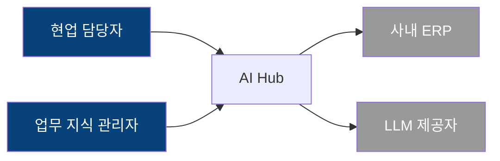
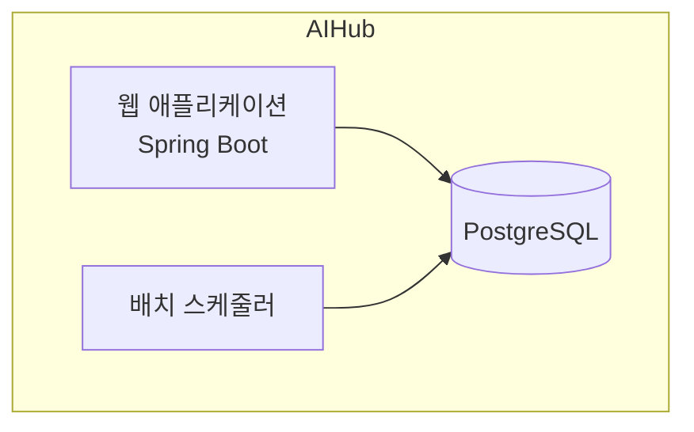

# P2 아키텍처 — 되돌릴 수 없는 것들을 먼저 정한다

> 목표: **되돌리기 비용이 큰 결정**을 근거와 함께 확정한다. 상세 설계는 아직 하지 않는다.
> 산출물: `documents/decisions/ADR-*.md`, `documents/spec/20-architecture.yaml`, `documents/spec/21-nfr.yaml`, `documents/spec/22-authz.yaml`
> 소요: 사용자 대화 1~2회 (대부분 AI가 제안하고 사용자가 승인)

## 1. 결정 순서 (의존성 순)

앞의 결정이 뒤의 선택지를 좁힌다. 순서를 지킨다.

```
1. 배포 환경 · 운영 주체        ← 여기가 나머지 전부를 제약한다
2. 아키텍처 스타일              (모놀리식 / 모듈러 모놀리식 / MSA)
3. 언어 · 런타임 · 프레임워크
4. 데이터 저장소                (RDB 종류, 캐시, 검색, 파일)
5. 인증 · 인가 모델
6. 통합 방식                    (외부 시스템별 동기/비동기, 프로토콜)
7. 프론트엔드 형태              (SSR/SPA, 모바일 대응)
8. 운영 요소                    (로깅, 모니터링, 배포 파이프라인, 백업)
```

## 2. 각 결정의 기본 원칙

### 원칙: 가장 지루한 선택지가 대체로 옳다
AI는 최신 기술을 제안하는 경향이 있다. 이 프로젝트의 기준은 다르다.

| 기준 | 우선순위 |
|---|---|
| 1 | **사용자 조직이 운영할 수 있는가** — 운영 인력 2명이면 쿠버네티스는 답이 아니다 |
| 2 | **제약(CON-###)을 만족하는가** — 사내 표준이 있으면 그것이 답이다 |
| 3 | **NFR 목표치를 만족하는가** |
| 4 | **가장 단순한가** |
| 5 | 그 다음에 성숙도·생태계·채용 가능성 |

### 기본 권장안 (특별한 이유가 없으면 이것으로 제안)
- **아키텍처**: 모듈러 모놀리식. MSA는 조직이 여러 팀으로 나뉘어 독립 배포가 필요할 때만.
- **DB**: 관계형 단일 DB. 트랜잭션 일관성이 대부분의 엔터프라이즈 업무의 핵심 요구다.
- **인증**: 조직 내부용이면 기존 SSO 연동. 없으면 세션 기반 + 표준 라이브러리.
- **비동기**: 필요가 증명되기 전엔 도입하지 않는다. (배치로 충분한 경우가 많다)
- **캐시**: NFR 측정 후 필요하면. 선제 도입 금지.

## 3. NFR 목표치 확정 (`documents/spec/21-nfr.yaml`)

P1의 NFR 요구사항을 **측정 가능한 숫자 + 측정 방법**으로 바꾼다.

```yaml
- id: NFR-002
  req: REQ-101
  category: performance
  target: "자연어 조회 p95 ≤ 2000ms"
  condition: "대상 100만 행, 동시 사용자 20명"
  measurement: "k6 부하 스크립트, tests/nfr/nl-query.js"
  test_case: TC-9002
  design_impact: "카탈로그 조회를 매 턴 DB 로 가지 않게 캐시 필요 (ENT-004)"
```

**`measurement:` 와 `test_case:` 가 없는 NFR은 게이트를 통과할 수 없다.** 측정하지 않을 목표는 목표가 아니다.

## 4. 사이징 계산 (근거를 남긴다)

```yaml
# documents/spec/20-architecture.yaml
sizing:
  users: { total: 300, concurrent_peak: 50, basis: "전체 300명 × 피크 동시율 15% + 여유" }
  data:
    - entity_hint: "조회 이력"
      volume_year1: "일 5,000턴 × 250일 = 125만 행/년"
      retention: "5년 → 625만 행 (개인정보 열람 이력은 감사 요건상 보존)"
  throughput: { peak: "질의 100건/분 (오전 보고 준비 시간대)" }
```

## 5. 권한 모델 (`documents/spec/22-authz.yaml`)

권한은 나중에 붙일 수 없다. **여기서 모델을 정한다.**

```yaml
model: rbac_with_scope        # rbac | rbac_with_scope | abac
scopes:
  - name: org_unit            # 데이터 범위 축
    description: "사용자는 소속 조직의 데이터만 접근"
roles:
  - id: ROLE-001
    name: 현업 담당자
    actor: ACT-001
    scope: "own_org"
    permissions: ["query:run", "query:read_own", "catalog:read"]
  - id: ROLE-004
    name: 업무 지식 관리자
    actor: ACT-003
    scope: "own_org"
    permissions: ["catalog:create", "catalog:review"]
```

**반드시 확인할 것**: 데이터 범위 축(부서별? 법인별? 담당 시스템별?)이 있는가.
있다면 **모든 테이블에 그 축의 컬럼이 필요**하고, 이건 P3 ERD 전에 알아야 한다.

## 6. ADR 작성 대상 (최소 목록)

이번 단계에서 최소한 아래는 ADR로 남긴다. 없으면 게이트 미충족.

| ADR | 주제 |
|---|---|
| ADR-001 | 배포 환경 및 운영 모델 |
| ADR-002 | 아키텍처 스타일 |
| ADR-003 | 기술 스택 (언어/프레임워크) |
| ADR-004 | 데이터 저장소 |
| ADR-005 | 인증·인가 방식 |
| ADR-006 | 외부 시스템 통합 방식 |
| ADR-007 | 이력·감사 로그 전략 |
| ADR-008 | 동시성 제어 전략 (낙관락/비관락/기준) |
| ADR-009 | 오류 처리·에러코드 체계 |
| ADR-010 | 개인정보·민감정보 처리 |

## 7. 아키텍처 다이어그램 (C4, Mermaid)

```markdown
### Level 1 — 시스템 컨텍스트


### Level 2 — 컨테이너

```

## 8. P2 흔한 실패와 방어

| 실패 | 방어 |
|---|---|
| AI가 과잉 아키텍처를 제안 | "운영 인력 몇 명인가요?"를 먼저 확인. 답이 1~2명이면 단순안만 제시 |
| NFR이 숫자 없이 통과 | `measurement:` 없는 NFR은 게이트에서 자동 미충족 |
| 권한 범위 축을 놓침 | P2에서 명시적으로 묻는다. P3에서 발견하면 ERD 전면 수정 |
| 기존 시스템 연동을 낙관 | 연동 대상별로 "지금 API가 있나요? 없으면 누가 만드나요?" 확인 |
| ADR에 대안이 하나 | 훅이 검사한다. 대안 2개 미만이면 경고 |

## 9. G2 게이트
체크리스트 → 레드팀 → 승인 → `current.phase: P3`
