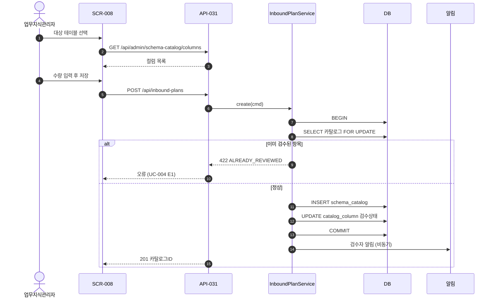

# P3 설계 — 베이스라인을 만든다 (가장 무거운 단계)

> 목표: 구현에 필요한 모든 것을 확정하고 **spec을 동결**한다.
> 산출물: `documents/spec/30-usecases.yaml` `31-features.yaml` `40-domain.yaml` `50-api.yaml` `51-interfaces.yaml` `60-screens.yaml` `70-testcases.yaml` + `documents/generated/` 생성물
> 소요: 프로젝트의 40% — 여기에 시간을 쓰는 것이 이 방법론의 핵심 베팅이다

## 1. 작업 순서 (의존성 순 — 뒤집으면 재작업)

```
① 유즈케이스        UC-###   (REQ → UC)
② 기능 목록·메뉴     FEAT-### (UC → FEAT, 메뉴 트리)
③ 도메인/데이터 모델  ENT-###  (FEAT가 다루는 개념 → 엔티티)
④ API 명세          API-###
⑤ 화면 정의         SCR-###
⑥ 시퀀스 다이어그램   (핵심 UC)
⑦ 테스트 케이스      TC-###
⑧ 슬라이스 백로그
⑨ 추적성 검사 → 문서 생성 → 게이트
```

**③을 ②보다 먼저 하지 않는다.** 기능을 모르고 만든 테이블은 반드시 다시 만든다.

---

## 2. ① 유즈케이스 (`documents/spec/30-usecases.yaml`)

```yaml
- id: UC-004
  name: 스키마 카탈로그 등록
  actors: { primary: ACT-004, secondary: [ACT-003] }
  reqs: [REQ-011, REQ-012]
  process_step: PRC-01-01
  precondition: "업무 지식 관리자로 로그인, 대상 DB 연결이 등록되어 있음"
  trigger: "새 업무 시스템을 조회 대상으로 붙인다"
  main_flow:
    - "1. 대상 DB 연결을 고른다"
    - "2. 시스템이 대상 DB 의 테이블·컬럼 목록을 읽어 온다"
    - "3. 컬럼마다 업무 의미와 예시 값을 입력한다"
    - "4. 저장한다"
    - "5. 시스템이 항목을 검수대기로 두고 검수자에게 알림을 보낸다"
  alternative_flows:
    - id: A1
      at_step: 1
      condition: "물리 스키마에 없는 논리 컬럼을 등록"
      flow: ["직접 입력 선택 → 근거 입력 → 검수자 승인 대기 상태로 저장"]
  exception_flows:                      # ★ 최소 1개 필수
    - id: E1
      at_step: 4
      condition: "물리 스키마에 없는 컬럼명을 입력"
      flow: ["오류 표시 '대상 테이블에 없는 컬럼입니다' → 저장 중단"]
    - id: E2
      at_step: 4
      condition: "동일 테이블의 카탈로그 항목이 이미 존재"
      flow: ["기존 항목 표시 → 수정 또는 컬럼만 추가 선택"]
  postcondition: "카탈로그 항목(상태=검수대기) 생성"
  business_rules:
    - "검수를 거치지 않은 항목은 조회 계획에 쓰이지 않는다"
    - "컬럼 하나에 업무 의미는 하나만 등록한다"
```

**규칙**: `exception_flows` 가 비면 게이트 미충족. 예외 없는 업무는 없다.

---

## 3. ② 기능 목록과 메뉴 (`documents/spec/31-features.yaml`)

UC는 **업무 관점**, FEAT는 **시스템이 제공하는 것** — 1:N일 수 있다.

```yaml
menu:                                    # 메뉴 트리 = 사용자가 보는 구조
  - id: MNU-01
    name: 업무 지식 관리
    children:
      - { id: MNU-01-01, name: 카탈로그등록, feature: FEAT-012, roles: [ROLE-004, ROLE-003] }
      - { id: MNU-01-02, name: 카탈로그조회, feature: FEAT-013, roles: [ROLE-001, ROLE-003, ROLE-004] }

features:
  - id: FEAT-012
    name: 스키마 카탈로그 등록
    usecases: [UC-004]
    reqs: [REQ-011, REQ-012]
    type: transaction                    # transaction | inquiry | master | batch | report | interface
    description: "관리자가 테이블에 업무 의미를 붙여 등록한다"
    entities: [ENT-004, ENT-005]
    apis: [API-031, API-032]
    screens: [SCR-008]
    roles: [ROLE-004, ROLE-003]
    complexity: medium                   # low | medium | high — 슬라이스 크기 산정용
```

**기능 유형별 누락 점검** — 아래 유형이 하나도 없으면 놓친 것이다.
`master`(기준정보 관리) · `batch`(정기 처리) · `report`(집계/출력) · `interface`(연동) · 권한/사용자 관리 · 공통코드 관리 · 감사로그 조회

---

## 4. ③ 데이터 모델 (`documents/spec/40-domain.yaml`)

```yaml
entities:
  - id: ENT-004
    name: schema_catalog
    display_name: 스키마 카탈로그
    term: TRM-004                        # 용어사전 연결
    features: [FEAT-012, FEAT-013]
    description: "테이블·컬럼에 붙인 업무 의미"
    attributes:
      - { name: plan_id,      type: "BIGINT",        pk: true,  generated: sequence }
      - { name: plan_no,      type: "VARCHAR(20)",   null: false, unique: true, rule: "IP-YYYYMMDD-NNN" }
      - { name: vendor_id,    type: "BIGINT",        null: false, fk: "ENT-002.vendor_id" }
      - { name: warehouse_id, type: "BIGINT",        null: false, fk: "ENT-001.warehouse_id", note: "권한 범위 축" }
      - { name: status,       type: "VARCHAR(20)",   null: false, enum: [PLANNED, ARRIVED, INSPECTING, COMPLETED, CANCELLED] }
      - { name: plan_date,    type: "DATE",          null: false }
    indexes:
      - { name: ix_plan_wh_date, columns: [warehouse_id, plan_date, status], reason: "FEAT-013 목록 조회 (NFR-002)" }
    audit: standard                      # none | created_only | standard(4컬럼) | full(변경이력 테이블)
    history: separate_table              # none | separate_table | temporal
    delete_policy: soft                  # hard | soft | never
    retention: "5년 후 아카이브"
    state_machine:                       # 상태가 있으면 반드시 전이 정의
      PLANNED:    [ARRIVED, CANCELLED]
      ARRIVED:    [INSPECTING, CANCELLED]
      INSPECTING: [COMPLETED]
      COMPLETED:  []
      CANCELLED:  []
```

### DBA 체크리스트 (엔티티마다)
- [ ] PK가 있는가. 자연키가 따로 있으면 unique 제약이 있는가
- [ ] 권한 범위 축 컬럼(`warehouse_id` 등)이 있는가 ← P2에서 정한 것
- [ ] 상태 컬럼이 있으면 `state_machine` 이 정의되었는가
- [ ] 이력이 필요한가 (`history`), 감사 컬럼은 (`audit`)
- [ ] 삭제 정책은 (`delete_policy`) — soft면 조회에 항상 필터가 필요함을 인지
- [ ] 금액/수량은 `DECIMAL` 인가 (`FLOAT` 금지)
- [ ] 날짜/시각의 타임존 정책이 일관되는가
- [ ] 목록 조회 패턴에 맞는 인덱스가 있고 `reason` 이 적혔는가
- [ ] 코드성 컬럼이 enum인가 공통코드 테이블인가 (일관되게)

### 공통 규칙 (한 번 정하고 전 테이블 적용)
```yaml
conventions:
  naming: snake_case
  pk_strategy: "BIGINT sequence"
  audit_columns: [created_at, created_by, updated_at, updated_by]
  soft_delete_column: deleted_at
  timezone: "UTC 저장, 표시 시 Asia/Seoul 변환"
  money_type: "DECIMAL(18,4)"
```

---

## 5. ④ API (`documents/spec/50-api.yaml` — OpenAPI 3 호환)

```yaml
- id: API-031
  feature: FEAT-012
  method: POST
  path: /api/admin/schema-catalog/create
  summary: 스키마 카탈로그 등록
  auth: required
  roles: [ROLE-004, ROLE-003]
  request:
    body:
      vendor_id:    { type: integer, required: true }
      warehouse_id: { type: integer, required: true }
      plan_date:    { type: string, format: date, required: true, rule: "오늘 이후" }
      items:        { type: array, minItems: 1 }
  responses:
    201: { plan_id: integer, plan_no: string }
    400: "VALIDATION_ERROR"
    409: "DUPLICATE_CATALOG — UC-004 E2"
    422: "COLUMN_NOT_FOUND — UC-004 E1"
  transaction: "카탈로그 생성 + 컬럼 항목 등록을 단일 트랜잭션"
  idempotency: "요청 헤더 Idempotency-Key 지원"
```

**모든 UC 예외 흐름이 에러 응답으로 매핑되어야 한다.** 매핑 안 된 예외 흐름이 있으면 게이트 미충족.

---

## 6. ⑤ 화면 (`documents/spec/60-screens.yaml`)

```yaml
- id: SCR-008
  feature: FEAT-012
  name: 카탈로그등록
  menu: MNU-01-01
  type: form                             # list | form | list_detail | dashboard | popup | wizard
  roles: [ROLE-004, ROLE-003]
  layout_note: "상단 대상 테이블 선택, 하단 컬럼 그리드(행 추가/삭제)"
  fields:
    - { name: 대상테이블, control: search_popup, required: true, source: API-020 }
    - { name: 업무영역,   control: code_select,  required: true, group: "CATALOG_DOMAIN" }
    - { name: 컬럼그리드, control: grid, min_rows: 1,
        columns: [컬럼명, 물리타입, 업무의미, 예시값],
        validation: "업무의미 필수, 컬럼명은 물리 스키마에 존재" }
  actions:
    - { name: 저장, api: API-031, confirm: false, on_success: "목록으로 이동 + 카탈로그ID 표시" }
    - { name: 취소, action: "변경분 있으면 확인 후 목록으로" }
  error_display:
    - { code: COLUMN_NOT_FOUND, message: "대상 테이블에 없는 컬럼입니다", target: "해당 그리드 행" }
  empty_state: "선택한 테이블에 등록할 컬럼이 없습니다"
  loading: "저장 중 버튼 비활성화 (중복 제출 방지)"
```

화면 정의서에는 **행복 경로만 그리지 않는다.** `error_display` · `empty_state` · `loading` · 권한별 차이가 필수다.

---

## 7. ⑥ 시퀀스 다이어그램 (`documents/generated/33-시퀀스/UC-###.md`)

핵심 UC(최소 3개: 가장 복잡한 것, 외부 연동, 트랜잭션 경계가 까다로운 것)에 작성.



**시퀀스에는 예외 분기(alt)와 트랜잭션 경계를 반드시 표시한다.**

---

## 8. ⑦ 테스트 케이스

`aidd-guide/quality/test-design.md` §1 참조. FEAT마다 최소 세트(정상·입력검증·업무예외·권한)를 채운다.
**구현 전에 TC가 존재해야 한다.** 이것이 P4의 TEST-FIRST를 가능하게 한다.

## 9. ⑧ 슬라이스 백로그

`aidd-guide/process/07-slice.md` §2 순서 규칙(의존성 → 리스크 → 가치)으로 정렬해
`documents/project.state.yaml` 의 `slices:` 에 기록한다.

## 10. ⑨ 마무리

```
/trace          → 추적성 오류 0 확인
/doc-gen        → documents/generated/ 전체 생성
/phase-gate G3  → 체크리스트 + 레드팀 + 승인 요청
```

**승인되는 순간 `documents/spec/` 은 베이스라인이다.** 이후 변경은 전부 CR.

## 11. P3 흔한 실패와 방어

| 실패 | 방어 |
|---|---|
| AI가 ERD를 먼저 그린다 | 순서 강제. FEAT 없이 ENT를 만들면 훅이 경고 |
| 예외 흐름이 비어 있다 | 게이트 자동 검사 |
| 관리 기능(사용자/권한/공통코드)을 빠뜨린다 | §3의 기능 유형 체크리스트 |
| 화면 정의가 행복 경로뿐 | `error_display`/`empty_state` 필수 필드 |
| 상태 컬럼에 전이 정의가 없다 | `state_machine` 필수 |
| ASM을 남긴 채 게이트 통과 시도 | G3는 미해결 ASM 0건이 조건 |
| 설계가 너무 길어져 사용자가 지친다 | 도메인 영역별로 쪼개 부분 승인 (조회 영역 먼저, 실행 영역 다음) |
