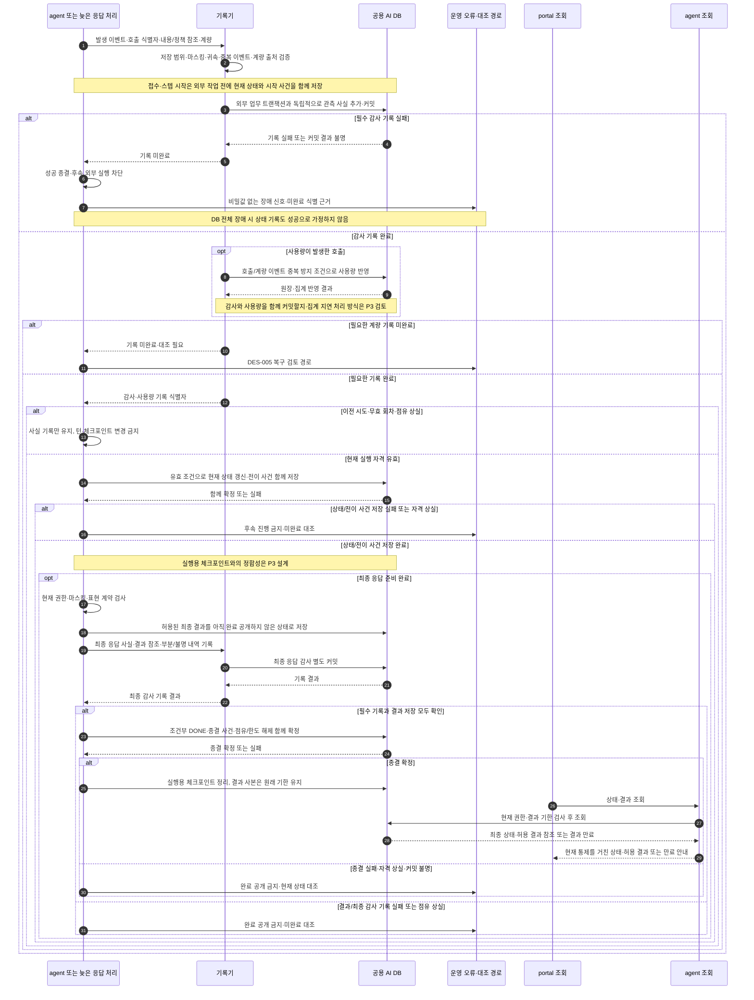

# 감사·사용량·상태 기록과 최종 응답 종결 시퀀스

아래 ‘읽는 순서’의 번호는 여러 메시지를 업무 단계로 묶은 설명 번호이며, 그림의 화살표 자동 번호와는 다릅니다. 조건에 맞는 분기만 실행하고, 병행 경로는 동시에 진행됩니다.

[전체 연결](agent-request-sequences.md)의 모든 기록기 호출이 참조하는 공통 처리다.
정본은 [REQ-107](../spec/10-requirements/003-security.yaml), [REQ-108·109](../spec/10-requirements/004-audit-quality.yaml), [NFR-010·012·015·027](../spec/21-nfr/_index.yaml)이다.
업무 규칙은 기존 정본을 따르며 아래 기록 구조·저장 순서는 상세 설계 제안이다. 물리 스키마·트랜잭션의 확정과 실행 시험은 남아 있다.
월 사용량 집계·호출 원장·실행 제어·대기열·현재 상태·감사의 저장 역할과 복구 시험 기준은 [REQ-036](../spec/10-requirements/002-in-flight-input.yaml)의 storage_design·concurrency_rules·verification을 따른다.

2026-10-14 감사 보완: 요청 의도와 실제 처리 유형·자료 출처·업무 연관성/비업무 추정·전송 동의와 실제 호출·관리자 검토를 REQ-107.audit_classification으로 연결한다. 선행 필수 동의/전송 시도 기록 실패면 외부 전송을 시작하지 않는다. 관련 카드 재확정 뒤 REQ-010 최종 보완에서 이 분기와 필터 조회·검토 경로를 상세화한다.

## 1. 서로 다른 기록과 연결 정보

| 기록 | 남기는 것 | 변경·접근 원칙 |
|---|---|---|
| 턴/스텝 현재 상태 | 접수·시작·현재 시도/회차·진행/대기/종결·시각·버전 | 시작부터 저장하고 조건부 갱신; 해당 전이 사건과 함께 확정 |
| 실행용 체크포인트 | 다음 스텝·대기 입력·유효 결과 참조·실행 문맥 | 유효 실행만 사용; 종결/무효 회차 정리와 결과 사본 수명 분리 |
| 필수 감사 이력 | 접수·시작·상태 전이·판정/보정·호출·재시도·인계/점유·중단·최종 응답의 사실 | 추가 후 불변; 외부 업무 롤백·점유 상실과 독립, 현재 상태 변경과 그 전이 사건은 함께 확정 |
| 사용량 원장 | 호출별 공급자 계량·추정·미상·귀속·발생 시점·차감 근거 | 성공/실패/취소 모두 대상; 같은 호출/계량 이벤트 재수신을 중복 차감하지 않음 |
| 개인별 월 사용량 집계 | 사용자·적용 월별 누적 사용량·집계 근거 | 원장으로 대조·재구축; 실행 대기열과 별도 관리; 점유 해제로 사용량을 취소하지 않음 |
| 기술 추적·오류 | 구간 시간·오류 코드·상관 식별·재시도·점유 이상 | 감사 원장의 대체가 아님; 비밀값·전송 금지 원문을 일반 로그에 복제하지 않음 |
| 조회 결과 사본 | 결과 식별/버전·마스킹 데이터·수신/원래 만료 시각·정책 원천·보호/파기 상태 | REQ-107.retention_policy 적용; 턴 종료 시 삭제하지 않음 |

호출·기록에는 사용자 또는 시스템 귀속, 세션/턴/시도/회차/스텝/호출 식별자, 점유 토큰·인스턴스, 발생/수신/기록 시각을 연결한다.
대기·입력 이벤트·승인·업무 액션은 각 식별자와 실제 인자 참조를 더하고, 모델 호출은 역할·공급 경로·모델·effort·계약/템플릿 버전·규칙 리비전을 연결한다.
내용 스냅샷과 현재 권한 판정 ID·판정 시각은 별도다. 식별자는 접근 권한을 대신하지 않는다.
필드명·필수 여부·서버 생성과 전달 규칙은 REQ-009의 계약 설계에서 확정한다.
사용자 진행 표시는 [REQ-006](../spec/10-requirements/001-04-progress-results.yaml)의 history_contract에 따라 기존 실제 처리 이력을 선별해 현재 진행과 누적 수행 내역으로 제공한다. 전체 감사의 마지막 행을 현재 진행으로 취급하지 않으며, 원 감사 기록의 보존과 사용자 공개 필드·현재 상태 판정은 구분한다. 업무 대상·실제 시작/완료 등의 표시 근거를 기존 이력 구조에서 제공할 수 있는지 상세 설계에서 확인한다. 같은 요구사항의 time_display와 NFR-008에 따라 작업 시작/종료 연결·합산 단위·대기 구간·시도/회차 소계를 제공하고, 상세 목록의 페이징이나 비공개 원문 때문에 허용된 턴 합계가 달라지지 않게 한다.

공식 엑셀·차트 이미지 내보내기는 [REQ-011](../spec/10-requirements/001-04-progress-results.yaml)의 export_audit를 따른다. 현재 정책/한도 판정·필수 시도 기록이 완료된 뒤 portal이 파일을 생성하고 후속 생성/개시·실패/취소 보고를 연결한다. 미보고는 미확인으로 남기며 디스크 저장 완료로 추정하지 않는다. 기존 system 사후 비동기 로그와의 재사용 범위·실제 메시지/감사 시퀀스는 P3에서 설계한다.

### 기록이 쌓이는 순서

1. 접수 성공을 알리기 전에 턴/시도와 접수 사건을 저장합니다. 실제 스텝도 작업 시작 전에 시작 기록을 만듭니다.
2. 진행·대기·종료 때 현재 상태는 갱신하고 변경 사건은 추가합니다. 재시도는 이전 건을 초기화하지 않고 새 실행 건으로 연결합니다.
3. 반복 호출마다 호출 식별자·시도 순번·입출력 참조·사용량을 연결합니다. 지연 분류나 관리자 보정도 원 판정을 남긴 채 추가합니다.
4. 서버 장애·점유 만료·중단·늦은 응답은 관측 사실과 현재 상태 변경 권한을 구분합니다. 외부 작업을 무조건 재실행하지 않고 남은 시작/호출 근거로 대조합니다.
5. Portal은 유효 현재 상태와 공개 가능한 이력을 읽습니다. 원문이 만료돼도 상태/시각/분류 등 감사 사실은 각 보관 정책을 따릅니다.

위 순서의 정본은 REQ-107.history_storage이며, 물리 테이블 수와 컬럼을 확정하는 그림은 아닙니다.

## 2. 쿼터 검사와 사용량 계량의 시점

| 시점 | 검사·계량 | 반드시 기록할 근거 |
|---|---|---|
| 새 턴·중단 후 새 시도 시작 전 | 현재 개인 한도와 커밋된 사용량 검사 | 사용자·대상 월·한도·사용량·판정 시각·허용/거부 |
| 처리 중 각 스텝 모델 호출 직전 | 설정 활성 시 재검사; 기본 false이면 쿼터 재검사 생략 | 당시 설정값/버전·판정값 또는 생략 사유 |
| 사용자대기 후 이어가기 | 새 시도 시작 검사로 취급하지 않음; 이후 호출 경계 설정 적용 | 현재 시도 유지·개인 한도 재확보·재검사 적용 근거 |
| 호출 결과·취소·오류 수신 | 실제 발생한 사용량 전량 기록 | 호출 ID·단위·계량 출처·귀속·차감 규칙 |
| 관리자 운영 호출·지식 임베딩 | REQ-116·NFR-015의 쿼터 제외/시스템 비용 구분 | 서버가 판정한 목적·권한·귀속; 요청자가 임의로 제외 지정 불가 |

쿼터 검사 통과는 토큰 예약이 아니다. 동시 호출·계량 지연과 재검사 비활성으로 개인 한도를 넘을 수 있으며 초과분을 버리지 않는다.
공급 경로 총 토큰이 있으면 우선 사용하고, 없으면 등록된 비중복 필드 조합을 적용한다. 입력에 포함된 캐시를 다시 더하지 않는다.
계량값이 전혀 없으면 실제 전송·수신 본문을 당시 계산기로 산출한 입력·출력 추정치를 기록하고 출처·계산기 버전을 남긴다.
알 수 없는 캐시 등 단위를 0으로 기록하지 않는다. 계량 형식이 미등록이면 사용자 쿼터 적용 호출을 허용하지 않는다(NFR-010).
취소·연결 단절로 본문 일부만 남았다면 공급자 전체 청구량을 알 수 있다고 주장하지 않는다. 추정 근거·관측 범위·미상을 남기고 월 대조에 연결한다.

## S8 감사 사용량 최종 응답 종결

**S8 검토 위치** — [REQ-010 요구사항](../generated/10-요구사항정의서/04-요구사항/02-질의-해석과-실행.md#req-010-요구사항) · [전체 흐름도](../generated/10-요구사항정의서/04-요구사항/02-질의-해석과-실행.md#req-010-전체-흐름도) · [단계별 대응표](../generated/10-요구사항정의서/04-요구사항/02-질의-해석과-실행.md#req-010-단계별-대응표) · [이 그림의 순서 설명](#s8-읽는-순서)

**관련 처리 경로** — [S1 접수·시작·비동기 폴링](agent-request-sequences.md#s1-접수-시작-비동기-폴링) · [S2 반복 모델 호출과 쿼터 검사](agent-call-sequences.md#s2-반복-모델-호출과-쿼터-검사) · [S3 파라미터·승인·SQL·업무 API](agent-call-sequences.md#s3-파라미터-승인-sql-업무-api) · [S4 질의 임베딩·지식 재임베딩](agent-call-sequences.md#s4-질의-임베딩-지식-재임베딩) · [S5 사용자대기·다른 인스턴스 이어가기](agent-lifecycle-sequences.md#s5-사용자대기-다른-인스턴스-이어가기) · [S6 다른 인스턴스의 변경·중단 입력](agent-lifecycle-sequences.md#s6-다른-인스턴스의-변경-중단-입력) · [S7 점유 만료·늦은 응답·새 시도](agent-lifecycle-sequences.md#s7-점유-만료-늦은-응답-새-시도)

**검토 순서** — [← S7 이전 검토](agent-lifecycle-sequences.md#s7-점유-만료-늦은-응답-새-시도)

### S8 읽는 순서

1. agent가 발생한 이벤트, 호출 식별자, 내용·정책의 참조와 계량값을 기록기에 전달합니다. 기록기는 감사·사용량 저장을 맡은 공통 기능이며 별도 서버를 뜻하지 않습니다.
2. 기록기는 저장해도 되는 정보인지, 마스킹과 비용 귀속이 맞는지, 중복 이벤트인지, 계량값의 출처가 무엇인지 확인합니다. 감사 관측 사실은 외부 업무 처리와 독립적으로 저장합니다. 접수와 스텝 시작은 작업 전에 기록하며, 현재 상태 변경과 해당 전이 사건은 함께 확정합니다(REQ-107.history_storage).
3. 필수 감사 저장이 실패하거나 커밋 결과가 불명이면 기록 미완료를 알립니다. agent는 성공 종결과 후속 외부 실행을 막고 운영 장애·대조 경로로 연결합니다. DB 전체가 고장 났다면 실패 상태까지 DB에 저장됐다고 가정하지 않습니다.
4. 감사가 저장됐고 사용량이 발생한 호출이면, 같은 호출·계량 이벤트를 중복 차감하지 않도록 사용량을 반영합니다. 필요한 계량 기록이 완료되지 않았으면 복구·대조 경로로 가며 정상 완료로 넘어가지 않습니다.
5. 필요한 기록이 끝나면 기록 식별자를 agent에 돌려줍니다. 이전 시도나 무효 회차의 응답이거나 점유를 잃은 실행자라면 사실 기록만 남기고 현재 턴·체크포인트를 바꾸지 않습니다.
6. 현재 실행 자격이 유효하면 현재 상태 갱신과 전이 사건을 함께 저장합니다. 실패하면 다음 작업으로 진행하지 않습니다. 체크포인트와의 정합성은 상세 설계에서 구체화합니다. 최종 응답이 아직 준비되지 않았다면 여기서 기록 처리를 마치고 나머지 업무 흐름을 계속합니다.
7. 최종 응답이 준비됐다면 현재 권한·마스킹·표현 형식을 검사하고 결과를 저장하되, 아직 완료로 공개하지 않습니다. 이어서 최종 응답의 사실과 결과 참조, 부분 처리·결과 불명 내역을 감사 이력으로 저장합니다.
8. 결과 저장과 필수 기록이 모두 확인되고 실행 자격도 유효할 때만 완료 상태와 종결 사건을 함께 확정하고 실행 점유와 개인 한도 집계를 해제합니다. 실행용 체크포인트는 정리하되 결과 사본은 원래 기한까지 남깁니다. 기록 실패나 점유 상실이면 완료로 공개하지 않고 대조 경로로 갑니다.
9. portal은 조회 담당 agent를 통해 최종 상태와 결과를 받습니다. 조회 시점의 권한과 데이터 통제를 다시 적용하며, 서버의 완료 상태가 사용자의 실제 열람을 뜻하지는 않습니다.

[↑ S8 다이어그램](#s8-감사-사용량-최종-응답-종결) · [전체 흐름도로 돌아가기](../generated/10-요구사항정의서/04-요구사항/02-질의-해석과-실행.md#req-010-전체-흐름도) · [← S7 이전 검토](agent-lifecycle-sequences.md#s7-점유-만료-늦은-응답-새-시도)

portal은 DB에 직접 접근하지 않는다. 조회의 자세한 경로는 DES-002를 따른다.
`최종 응답 사실`은 서버가 응답을 준비·저장했다는 의미이며 사용자 열람 사실을 만들지 않는다. 열람 계측은 별도 요구가 있을 때 정의한다.
최종 결과 저장과 감사 커밋 사이에 프로세스가 죽으면 저장된 결과가 있어도 성공으로 공개하지 않는다. 복구가 외부 업무 재실행으로 이어져서는 안 된다.
호출 시작·결과 원장과 감사·사용량을 양방향 대조한다. 감사 테이블만 세면 아예 기록되지 않은 호출을 발견할 수 없다(NFR-027).

## 4. 저장 실패·중복·지연 시 설계해야 할 처리

| 상황 | 지켜야 할 경계 | P3에서 확정할 구현 |
|---|---|---|
| 전송 전 필수 기록 실패 | 새 외부 호출을 시작하지 않는 초안 경로 | 호출 원장과 감사 시작 기록의 커밋 범위 |
| 전송 후 결과/계량 기록 실패 | 실제 업무·비용을 없던 것으로 처리하지 않음 | 안전한 재기록 근거·보관 장소·재시도 상한·복구 담당 |
| DB 전체 장애 | 같은 DB에 실패 상태를 저장했다고 가정하지 않음 | 독립 장애 신호·복구 후 대조 수단; 원문 임의 로컬 적재 금지 |
| 커밋 응답 유실·중복 응답 | 중복 계량·중복 기록 재전송의 영향을 통제 | 이벤트 식별 키·유일 제약·기록 조회 후 재시도 |
| 사용량 원장과 월 집계의 불일치 | 원장으로 대조·복구하며 이중 차감하지 않음 | 원장/집계 커밋 범위·반영 식별자·재집계와 동시 정정의 경합 처리 |
| 계량 정정·늦게 온 확정 값 | 공급자값·추정치·미상과 변경 근거를 구분 | 원장 추가 조정과 집계 정합성; 원 이력 덮어쓰기 방지 |
| 점유 상실 후 응답 | 호출 사실·사용량은 남기되 상태는 되살리지 않음 | 감사/사용량 쓰기와 실행 상태 쓰기의 권한 분리 |
| 월 경계·지연 계량 | 현재 월로 임의 귀속하거나 과거 한도를 재산정하지 않음 | 발생 시각 기준·시간대·집계 지연 및 정정 규칙 |
| 완료/중단 후 상태 정리 | 체크포인트 정리로 별도 결과/감사 이력을 지우지 않음 | 시도/회차별 무효화·참조 분리·정리 실패 재처리 |
| 원문 기한 만료·조사 보호 | 일반 사용 차단과 보호 자료의 물리 파기 유예 구분 | 원래 만료 시각·보호 시작/해제와 읽기/파기 경합·일일 배치 |

별도 트랜잭션만으로 프로세스 급사 시 유실이 해결되지는 않는다. 외부 전송과 기록 사이의 실패 구간, 복구 원본을 만들 수 있는 범위는 상세 설계 미확정 사항이다.
따라서 현재 문서는 필수 이력 누락 0건을 이미 달성했다는 검증 근거가 아니다. 기록 실패를 조용히 성공 처리하지 않는 경계를 제시한다.

## 5. 구현 계약 시험으로 옮길 사례

| 주입할 상황 | 기대 결과 |
|---|---|
| 잔여 1,000에서 5,000 사용·재검사 false | 실제 5,000 기록, 진행 중 소진만으로 중단하지 않음, 다음 새 시도 검사에 반영 |
| 재검사 true·앞 호출로 한도 소진 | 다음 호출 전송 0건, 모델 없이 안내, 기존 업무·사용량 보존 |
| 같은 호출 결과를 두 번 전달 | 발생 사실 식별 가능, 개인 사용량 이중 차감 없음 |
| 실행 결과 수신 후 감사 저장 실패 | DONE 공개 0건, 결과 불명/미완료 근거로 안전한 대조, 업무 API 자동 재전송 0건 |
| 점유 만료 뒤 사용량 도착 | 이전 호출에 귀속해 기록, 현재 턴 상태·그래프 쓰기 0건 |
| 커밋은 됐지만 응답 유실 | 호출 식별자로 기존 기록 확인, 재기록으로 사용량 증가하지 않음 |
| 최종 결과 저장 뒤 최종 감사 실패 | portal에 성공 완료 공개 0건; 조회로 새 실행 생성 0건 |

@defer P3 위 식별·저장·계량 정정·복구 계약을 실제 스키마와 시험 ID에 연결하고 장애 주입으로 검증한다.
