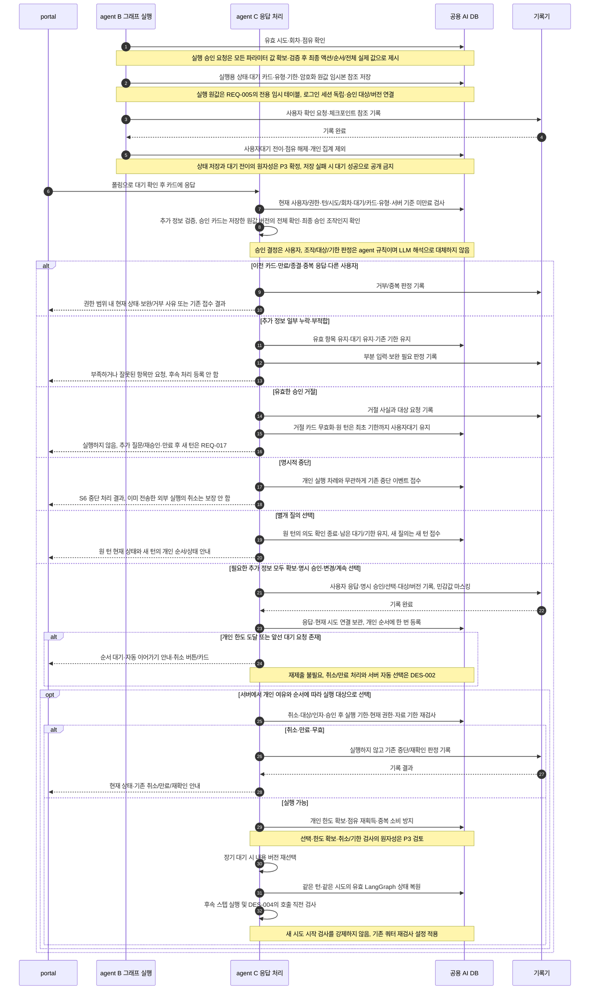
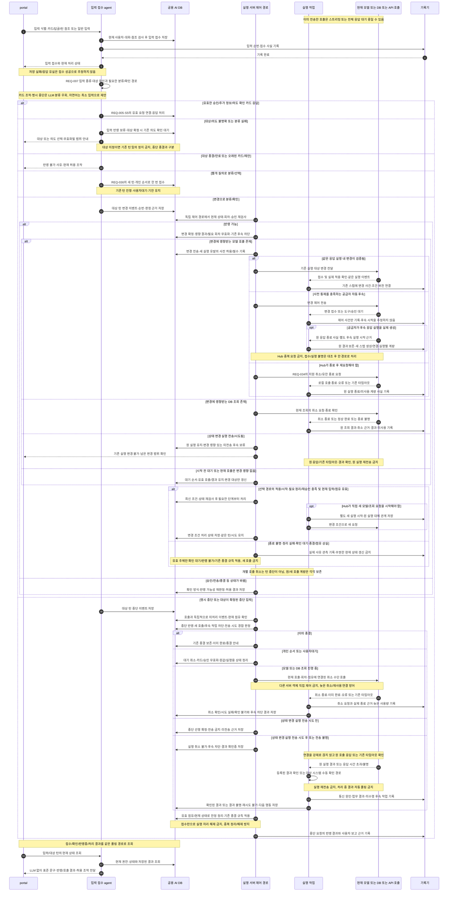
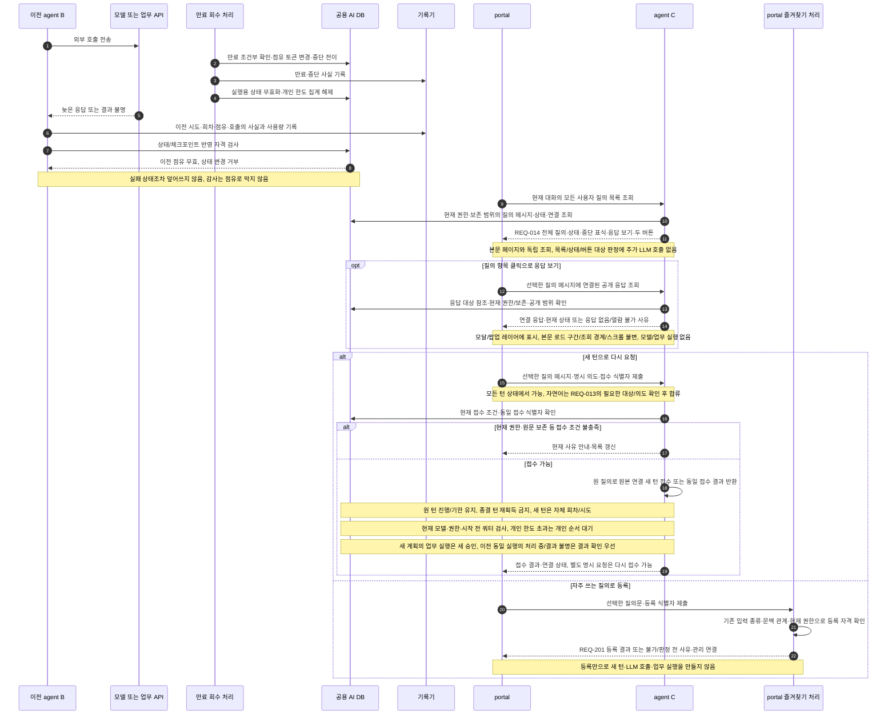

# 턴·그래프·실행 점유와 중단·이어가기 시퀀스

아래 ‘읽는 순서’의 번호는 여러 메시지를 업무 단계로 묶은 설명 번호이며, 그림의 화살표 자동 번호와는 다릅니다. 조건에 맞는 분기만 실행하고, 병행 경로는 동시에 진행됩니다.

[전체 연결](agent-request-sequences.md)의 실행 상세다. 상태·점유의 정본은 [용어](../spec/03-glossary/_index.yaml), [ARCH-070](../spec/20-architecture/013-execution-lease.yaml)이며 기존 [점유 설계](turn-execution.md)를 연결한다.
새 제품 상태 코드를 만들지 않는다. 기록기 호출은 [기록 실패 경로](agent-history-sequences.md)를 포함한다.

## 1. 상태를 구분하는 기준

| 대상 | 역할 | 저장·복원 경계 |
|---|---|---|
| 턴 | 사용자 요청 한 건과 현재 처리 상태 | 재접속은 조회; 명시 중단 재시도는 원본 참조를 가진 새 턴 |
| 시도 | 처음부터 시작하는 실행 단위 | 주 추론 공급 경로·모델·effort 고정; 새 시도는 새로 선택 |
| 회차 | 처리 중 변경으로 무효화된 지점부터 다시 처리 | 점유 토큰과 별개; 무효 회차 결과는 실행 입력에서 제외 |
| 스텝·호출 | 모델 응답 실행과 외부 전송/도구 호출의 연결 | 한 스텝은 관측 가능한 모델 응답 실행 1회; 연결·클라이언트 요청·콘텐츠 블록과 구분하고 자동 후속도 별도 실행으로 기록 |
| LangGraph 상태 | 다음 실행 위치와 유효 입력 참조 | 현재 시도·회차와 결합, 점유를 검증해 저장/복원 |
| 점유 | 현재 턴을 실행할 인스턴스의 자격 | 사용자대기에서 해제, 다시 얻을 때 토큰 변경; 감사 기록과 구분 |

## S5 사용자대기 다른 인스턴스 이어가기

**S5 검토 위치** — [REQ-010 요구사항](../generated/10-요구사항정의서/04-요구사항/02-질의-해석과-실행.md#req-010-요구사항) · [전체 흐름도](../generated/10-요구사항정의서/04-요구사항/02-질의-해석과-실행.md#req-010-전체-흐름도) · [단계별 대응표](../generated/10-요구사항정의서/04-요구사항/02-질의-해석과-실행.md#req-010-단계별-대응표) · [이 그림의 순서 설명](#s5-읽는-순서)

**관련 처리 경로** — [S1 접수·시작·비동기 폴링](agent-request-sequences.md#s1-접수-시작-비동기-폴링) · [S2 반복 모델 호출과 쿼터 검사](agent-call-sequences.md#s2-반복-모델-호출과-쿼터-검사) · [S3 파라미터·승인·SQL·업무 API](agent-call-sequences.md#s3-파라미터-승인-sql-업무-api) · [S7 점유 만료·늦은 응답·새 턴 요청](agent-lifecycle-sequences.md#s7-점유-만료-늦은-응답-새-턴-요청) · [S8 감사·사용량·최종 응답 종결](agent-history-sequences.md#s8-감사-사용량-최종-응답-종결)

**검토 순서** — [← S4 이전 검토](agent-call-sequences.md#s4-질의-임베딩-지식-재임베딩) · [S6 다음 검토 →](agent-lifecycle-sequences.md#s6-다른-인스턴스의-변경-중단-입력)

근거: REQ-005·013·017·032·036·040·105·107·108·109, NFR-012·023. 대기 응답과 같은 시도 이어가기는 REQ-005 검토 초안에 연결하며, 승인은 승인 요청·액션·인자·유효 시간에 결합한다.

### S5 읽는 순서

1. B가 사용자에게 추가 정보나 승인을 받아야 한다고 판단하면 현재 시도·회차와 실행 점유가 유효한지 확인합니다. 필요한 사용자 입력은 먼저 받고, 조회·기본값·시스템 매핑 등을 포함해 실제 호출에 쓸 모든 파라미터의 값을 확보·검증합니다. 미정 값을 남긴 최종 승인은 요청하지 않습니다. 실행 대상·순서·모든 항목의 실제 값을 사용자가 확인할 수 있게 제시한 뒤 최종 승인을 받으며, 필요 여부와 응답 유효성은 agent의 등록 계약·서버 규칙으로 판정합니다.
2. 나중에 이어갈 실행 상태와 대기 카드의 종류·기한을 공용 DB에 저장하고, 실행 파라미터 원값은 REQ-005의 전용 암호화 임시본 참조로 연결합니다. 승인 카드는 저장한 같은 버전의 실제 값을 현재 권한이 있는 요청 사용자에게 제시합니다. 감사에는 마스킹한 값과 대상/버전 참조만 남깁니다. 저장이 완료되지 않았는데 정상적인 사용자대기로 표시해서는 안 됩니다.
3. 사용자대기로 전환하면서 실행 점유를 놓고 개인 한도 집계에서 제외합니다. 사용자가 답할 때까지 처리 스레드나 실행 점유를 계속 유지하지 않습니다.
4. 사용자는 portal에서 대기 카드를 확인하고 응답합니다. 이 응답은 B가 아닌 C에 도착할 수 있습니다. C는 현재 사용자/권한과 턴·시도·회차, 대기 요청·카드·유형 및 서버 시각 기준 미만료를 확인합니다. 추가 정보는 필요한 값인지 검증하고, 실행 승인은 승인 카드의 명시적 조작만 받습니다. 일반 입력·계획/의도 확인은 실행 승인이 아닙니다.
5. 이전 카드·만료/종결·다른 사용자의 응답은 진행시키지 않습니다. 같은 제출의 중복 응답은 기존 접수 결과를 확인합니다. 추가 정보가 불완전하면 유효 항목을 기존 보존 정책 안에서 유지하고 부족·부적합 항목만 요청하며 대기와 기한을 유지합니다. 거절하면 해당 카드를 무효화하고 원 턴은 최초 기한까지 사용자대기를 유지합니다. 기한 만료 시 중단하며 이후 새 계획·승인은 새 턴으로 처리합니다(REQ-017). 명시적 중단은 실행 순서를 기다리지 않고 S6로, 별개 질의는 원 턴의 남은 대기 조건을 임의로 충족하지 않는 새 턴 접수로 분기합니다. 판정 기록과 공개 범위는 기존 감사·권한 규칙을 따릅니다.
6. 필요한 추가 정보가 모두 확보됐거나 명시적 실행 승인·변경/계속 선택으로 현재 처리를 계속할 수 있을 때만 응답과 현재 시도의 연결을 보관하고 사용자별 순서에 등록합니다. 한도가 찼거나 앞선 대기 요청이 있으면 자동 이어가기 예정과 취소 조작을 안내합니다. 같은 응답을 다시 제출할 필요가 없습니다.
7. 개인 여유가 생겨 차례가 되면 취소 여부·현재 권한·승인 대상/인자·승인 후 실행 유효 기한·자료 기한을 다시 검사합니다. 사용자 응답 접수 전의 대기 기한과 승인 뒤 실행을 시작할 기한을 구분하며, 접수 성공이나 순서 대기로 기한을 연장하지 않습니다. 취소·만료·무효면 실행하지 않고 기존 중단/재확인 경로를 표시합니다. 유효하면 개인 한도와 실행 점유를 확보하며 장기 대기의 내용 버전 규칙을 적용합니다.
8. 현재 시도의 유효한 LangGraph 상태와 원값 임시본 참조를 복원해 후속 단계를 이어갑니다. 원값은 로그인 세션과 독립적으로 유지하며 실제 호출은 S3에서 승인 버전·권한·기한을 다시 대조합니다. 처음부터 시작하는 새 시도는 아니며, 이후 모델 호출 시 쿼터 재검사 설정을 적용합니다. 만료·종결·회차/버전 무효화 시 원값 사용 차단과 삭제, 삭제 실패 재처리는 REQ-005를 따릅니다.

[↑ S5 다이어그램](#s5-사용자대기-다른-인스턴스-이어가기) · [전체 흐름도로 돌아가기](../generated/10-요구사항정의서/04-요구사항/02-질의-해석과-실행.md#req-010-전체-흐름도) · [← S4 이전 검토](agent-call-sequences.md#s4-질의-임베딩-지식-재임베딩) · [S6 다음 검토 →](agent-lifecycle-sequences.md#s6-다른-인스턴스의-변경-중단-입력)

대기 카드가 갱신되어도 기존 승인 대기 시작 시각·받은 승인의 유효 기한을 임의로 연장하지 않는다(REQ-026).
병행형 의도 확인은 처리중을 유지하므로 위 사용자대기·점유 해제 경로를 타지 않는다(REQ-032).
대기 만료 배치보다 사용자 응답이 먼저 도착해도 서버 시각상 이미 만료라면 이어갈 수 없다.

## S6 다른 인스턴스의 변경 중단 입력

**S6 검토 위치** — [REQ-007 정본](../spec/10-requirements/001-03-processing-intervention.yaml) · [전체 흐름도](../generated/10-요구사항정의서/04-요구사항/02-질의-해석과-실행.md#req-010-전체-흐름도) · [이 그림의 순서 설명](#s6-읽는-순서)

**검토 순서** — [← S5 이전 검토](#s5-사용자대기-다른-인스턴스-이어가기) · [S7 다음 검토 →](#s7-점유-만료-늦은-응답-새-턴-요청)

근거: REQ-005·007·030·031·032·033·034·035·036·105·107, ARCH-070. 입력 접수와 대상/의도 확정·반영을 구분하며 CLI/API 모두 같은 사용자 절차를 제공한다.

### S6 읽는 순서

1. 입력을 식별자·순서와 함께 저장하고 접수 사실을 알립니다. 현재 유효한 카드 응답은 REQ-005로 연결하며 명시 중단은 모델 분류를 거치지 않습니다. 자연어는 대상 확인과 필요한 분류·사용자 확인을 수행합니다. 대상 미정 입력 때문에 임의의 기존 턴을 정지하지 않습니다.
2. 대상·의도가 불명확하거나 분류가 실패하면 입력 반영을 보류합니다. 대상이 확정된 턴은 기존 의도 확인 대기에서 후속 진행을 보류하며 중단 종결과 구분합니다. 이미 전송한 호출은 REQ-007의 경계를 유지합니다. 별개 질의는 원 턴과 기한을 보존하고 새 턴으로 접수합니다.
3. 변경은 실행 서버가 현재 상태·회차·승인을 다시 검사한 후 확정합니다. 모델은 REQ-007.model_change_contract의 같은 실행 변경·공급자 자동 후속·Hub 종료 후 재요청을 구분합니다. 자동 후속의 접수와 실행 시작은 별개이며 사전 통제·중복 방지 조건을 적용합니다. DB 조회는 원 조회 종료 확인 뒤 새 조회로 처리하고, 영향 없는 조회·결과와 대기 순서는 유지합니다. 전송된 업무 실행은 보존하며 미전송 변경 범위를 확인·재승인받습니다. 같은 모델 실행이면 스텝에 변경 사건을 추가하고 실제 별도 실행이 생기면 원/후속 스텝과 계량을 각각 연결합니다. 개별 실행 종료를 턴 전체 중단으로 바꾸지 않습니다.
4. 승인·전송·종결 상태가 달라졌으면 이전 판정을 그대로 적용하지 않습니다. 실행값 변경은 재승인을 요구하고 이미 전송된 업무는 변경/재전송하지 않습니다. 무효화된 호출·분류 호출·변경 후 호출 사용량을 각각 남기며 추론의 중복 가산·계량 유실의 확정 0 처리를 막습니다(NFR-010).
5. 중단은 기존 REQ-007 경로를 적용합니다. 대기/미전송 작업 취소·카드/원값 무효화, 모델/DB 취소 요청과 실제 종료 확인, 전송한 업무 실행의 취소 불가·후속 차단을 구분합니다. 실제 결과 또는 기존 타임아웃을 확인하고 등록된 결과 확인/대상 시스템 수동 확인을 안내하며 실행 재전송은 금지합니다.
6. 호출과 독립된 제어 경로는 청크가 없는 동안에도 동작해야 합니다. 현재 호출·회차·점유에 묶인 객체만 제어하고 늦은 취소가 재사용된 연결이나 새 호출에 적용되지 않게 합니다. 중단 접수만으로 실행 자리를 해제하거나 종결을 완료로 되돌리지 않습니다.
7. agent가 저장된 사실로 접수/확인/반영 결과와 호출별 결과·다음 행동을 안내합니다. portal은 구현체별 별도 조작 없이 REQ-006·027·040의 폴링/재접속으로 이를 복원합니다. 반영 지연·취소 실패·확인 불가도 실제 상태대로 표시합니다.

입력 분류·단계별 변경/중단·취소 결과의 공통 정본은 REQ-007이다. 자연어 분류 입력은 REQ-035, 공통 통신 계약은 REQ-009, 병행/차단형 확인은 REQ-032, 이력과 사용량 연결은 REQ-107을 따른다.
@defer P3 대상/의도 확인·현재 상태 경합·CLI/API 변경 공통 시험과 실제 DBMS/드라이버 취소, 호출 객체 수명·전달/확인/정리 지연을 검증한다. 공급자 취소·추론/최종 계량·동시성은 운영 API 구독 확보 후 별도 시험한다.

## S7 점유 만료 늦은 응답 새 턴 요청

**S7 검토 위치** — [REQ-010 요구사항](../generated/10-요구사항정의서/04-요구사항/02-질의-해석과-실행.md#req-010-요구사항) · [전체 흐름도](../generated/10-요구사항정의서/04-요구사항/02-질의-해석과-실행.md#req-010-전체-흐름도) · [단계별 대응표](../generated/10-요구사항정의서/04-요구사항/02-질의-해석과-실행.md#req-010-단계별-대응표) · [이 그림의 순서 설명](#s7-읽는-순서)

**관련 처리 경로** — [S1 접수·시작·비동기 폴링](agent-request-sequences.md#s1-접수-시작-비동기-폴링) · [S5 사용자대기·다른 인스턴스 이어가기](agent-lifecycle-sequences.md#s5-사용자대기-다른-인스턴스-이어가기) · [S8 감사·사용량·최종 응답 종결](agent-history-sequences.md#s8-감사-사용량-최종-응답-종결)

**검토 순서** — [← S6 이전 검토](agent-lifecycle-sequences.md#s6-다른-인스턴스의-변경-중단-입력) · [S8 다음 검토 →](agent-history-sequences.md#s8-감사-사용량-최종-응답-종결)

### S7 읽는 순서

1. B가 모델이나 업무 API에 요청을 보낸 뒤 실행 점유가 만료되는 상황입니다. 외부 요청은 이미 나갔으므로 이후 만료 처리가 그 요청을 되돌리지는 못합니다.
2. 만료 회수 처리가 공용 DB에서 실제 만료 조건을 확인하고 점유 토큰을 바꾸면서 원 턴을 중단으로 종결합니다. 그 원 턴은 다시 점유하거나 실행할 수 없습니다. 만료 사실을 기록하고 실행용 상태를 무효화하며 개인 한도 집계를 해제합니다.
3. 뒤늦게 B에 응답이 도착하면 이전 시도·회차·점유·호출에 연결해 실제 결과와 사용량을 기록합니다. 결과를 알 수 없다면 불명으로 남기며 미실행으로 단정하지 않습니다.
4. B가 현재 턴이나 체크포인트를 변경하려 해도 이전 점유는 무효이므로 거부됩니다. 감사·사용량 기록은 남기지만 종료된 처리를 되살리지는 않습니다.
5. 사용자는 portal에서 현재 세션의 모든 사용자 질의를 별도 목록으로 확인합니다(REQ-014). 접수·개인 순서 대기·처리중·사용자대기·완료·실패·중단을 구분하고 중단 항목은 문구와 표식으로 드러냅니다. 본문 페이지 밖 질의도 찾으며 상태와 무관하게 응답 보기·새 턴 요청·자주 쓰는 질의 등록을 제공합니다. 질의 항목을 클릭하면 REQ-014.response_preview에 따라 정확히 연결된 공개 응답을 모달/팝업 레이어에서 확인합니다. 목록/레이어에는 본문 원본 위치로 이동하는 조작을 두지 않습니다. 응답을 조회해도 본문 로드 구간·과거 조회 경계·스크롤은 바뀌지 않습니다. 응답 대기·부분 응답·없음·권한/보존으로 열람 불가·조회 오류를 구분하고 닫은 뒤 읽던 위치와 작성 중 입력을 유지합니다. 목록/응답 열람·명시 버튼 대상 판정에는 추가 LLM 호출이 없습니다.
6. 새 턴 요청은 현재 권한·원문 보존 등 접수 조건을 다시 확인하고, 모든 상태의 원 질의로 원본 참조를 가진 새 턴을 만듭니다(REQ-013). 원 턴의 진행/기한은 유지하고 종결된 원 턴은 되살리지 않습니다. 새 모델·현재 권한·시작 전 쿼터를 적용하며 개인 한도가 차면 REQ-036의 순서로 대기합니다. 새 계획에서 업무 실행이 필요하면 전체 인자와 과거 실행 사실을 확인하고 새 승인을 받습니다. 이전 동일 실행이 처리 중/결과 불명이면 결과 확인 없이 재전송하지 않는 경계는 REQ-013.execution_boundary를 따릅니다. 이전 승인·결과·체크포인트를 실행 입력으로 승계하지 않으며 새 메시지는 REQ-019의 기록 순서로 추가하고 원본과 양방향 이동합니다.
7. 동일 접수 식별자의 연타·재전송·응답 유실은 기존 접수 결과로 수렴합니다. 원 질의가 같아도 사용자가 별도로 명시한 요청은 새 식별자로 접수하며, 연결된 새 턴의 진행/종결만으로 원 항목의 버튼을 영구 비활성화하지 않습니다. 권한·보존 등 현재 조건이 바뀌면 사유를 안내하고 목록을 갱신합니다. 목록만의 조회 실패는 빈 목록과 구분하고 본문 조회·새 입력·기존 턴 처리를 차단하지 않습니다.

8. 즐겨찾기 등록은 REQ-201.favorite_eligibility의 기존 입력 분류·문맥 관계를 확인합니다. 변경·추가 정보 응답·문맥 의존 입력은 제외하고 분류 미확정은 판정 전으로 표시하며 자격 판정 전용 모델 호출은 하지 않습니다. 허용된 질의문을 기존 개인 즐겨찾기로 저장하고 등록 결과와 관리 경로를 안내합니다. 동일 등록 요청의 재전송은 같은 결과를 반환합니다. 등록은 새 턴 요청이나 실행 승인이 아니며 LLM·도구를 호출하지 않습니다. 이후 즐겨찾기 선택은 입력창을 채우고 사용자의 전송으로 새 턴을 시작합니다.

[↑ S7 다이어그램](#s7-점유-만료-늦은-응답-새-턴-요청) · [전체 흐름도로 돌아가기](../generated/10-요구사항정의서/04-요구사항/02-질의-해석과-실행.md#req-010-전체-흐름도) · [← S6 이전 검토](agent-lifecycle-sequences.md#s6-다른-인스턴스의-변경-중단-입력) · [S8 다음 검토 →](agent-history-sequences.md#s8-감사-사용량-최종-응답-종결)

정상 배포 종료는 새 접수를 멈추고 현재 스텝 경계에서 다음 스텝을 시작하지 않은 채 중단·점유 해제로 끝낸다.
드레인 상한 초과는 점유 만료 회수로 넘기며, 사용자대기는 배포만으로 중단하지 않는다. 계약 주 버전 전환 예외는 ARCH-019를 따른다.
청크 경계·긴 모델 대기·비스트리밍 도구 실행 중 갱신은 [점유 설계](turn-execution.md)의 경로를 적용한다. 살아 있는 프로세스와 실제 작업 진행을 동일시하지 않는다.

## 5. 원자성·복원 검증 조건

- @defer P3 대기 응답과 만료, 이벤트 소비와 체크포인트, 점유 회수와 늦은 쓰기에 대해 하나의 유효 결과만 남는 조건부 저장을 검증한다.
- @defer P3 업무 상태와 LangGraph 체크포인트가 서로 다른 시도를 가리키는 저장 실패를 주입한다. 현재 시도·회차·계약 버전·점유 검증 없는 복원을 금지한다.
- @defer P3 이미 전송한 액션과 결과 불명 상태를 모르는 새 실행자가 재전송하지 않도록 호출 전 기록과 복원 판정을 대조한다. 점유만으로 정확히 한 번 실행을 보장하지 않는다.
