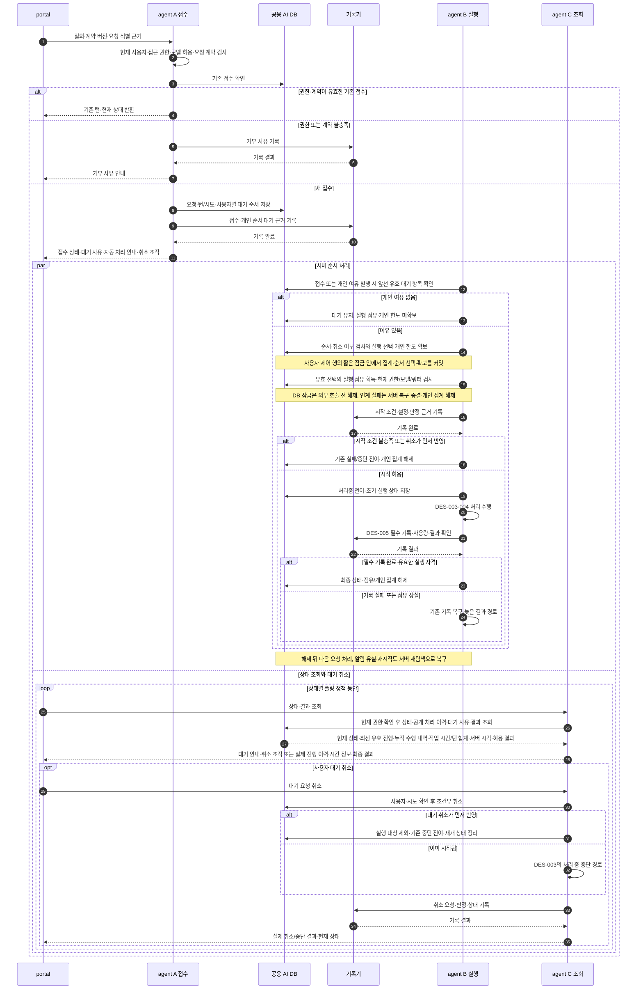

# 질의 접수·폴링과 상세 시퀀스 연결

아래 ‘읽는 순서’의 번호는 여러 메시지를 업무 단계로 묶은 설명 번호이며, 그림의 화살표 자동 번호와는 다릅니다. 조건에 맞는 분기만 실행하고, 병행 경로는 동시에 진행됩니다.

REQ-010의 [전체 흐름도](../generated/10-요구사항정의서/04-요구사항/02-질의-해석과-실행.md#req-010-전체-흐름도)를 구현 관점으로 읽는 상세 시퀀스 초안이다.
제품 사실의 정본은 [요구사항](../spec/10-requirements/_index.yaml)과 [아키텍처](../spec/20-architecture/_index.yaml)이며, 이 문서로 미확정 정책이나 게이트를 승인하지 않는다.
그림은 논리 처리 순서를 제안한다. 저장 역할과 사용자별 짧은 행 잠금의 설계 기준은 [REQ-036](../spec/10-requirements/002-in-flight-input.yaml)을 따른다. 클래스·API 이름·물리 DB 테이블·정확한 트랜잭션 경계는 P3에서 확정한다.

## 1. 읽는 순서와 주체

**검토 시작:** [전체 흐름도와 단계별 대응표](../generated/10-요구사항정의서/04-요구사항/02-질의-해석과-실행.md#req-010-전체-흐름도) → 해당 S 번호의 다이어그램 또는 순서 설명 → 관련 처리 경로 → 전체 흐름도 복귀. S1~S8은 검토용 순번이며 실제 실행 순서가 아니다.

| 문서 | 시퀀스 | 구현 시 확인할 것 |
|---|---|---|
| 이 문서 | 접수·개인 한도·폴링 | 시작 전 쿼터, 영속 접수, 다른 인스턴스의 조회, 최종 상태 |
| [실행 수명주기](agent-lifecycle-sequences.md) | 사용자대기·이어가기, 변경·중단, 장애·만료·새 시도 | 상태와 LangGraph, 점유·개인 한도, 이벤트 순서·늦은 결과 |
| [모델·도구·임베딩](agent-call-sequences.md) | 반복 모델 호출, SQL·업무 API, 임베딩 | 호출 전 검사, 승인, 응답 검증, 사용량·부분 실행 |
| [기록과 종결](agent-history-sequences.md) | 감사·사용량 저장, 기록 실패·종결 | 별도 트랜잭션, 중복 계량 방지, 결과 공개·조회 |

portal은 브라우저 화면이다. agent A·B·C는 같은 기능을 제공하는 서로 다른 실행 인스턴스다.
DB는 공용 AI 전용 DB이고, 기록기는 별도 서버가 아니라 감사·사용량 저장의 논리 역할이다.
권한/쿼터 판정 역시 서비스 배포 단위를 뜻하지 않는다. 외부 업무 시스템·모델과 AI DB를 하나의 트랜잭션으로 묶지 않는다.
그림의 `기록`은 [DES-005](agent-history-sequences.md)의 실패 경로를 포함한다. 성공 응답이 없으면 후속 성공 경로로 진행하지 않는다.

## S1 접수 시작 비동기 폴링

**S1 검토 위치** — [REQ-010 요구사항](../generated/10-요구사항정의서/04-요구사항/02-질의-해석과-실행.md#req-010-요구사항) · [전체 흐름도](../generated/10-요구사항정의서/04-요구사항/02-질의-해석과-실행.md#req-010-전체-흐름도) · [단계별 대응표](../generated/10-요구사항정의서/04-요구사항/02-질의-해석과-실행.md#req-010-단계별-대응표) · [이 그림의 순서 설명](#s1-읽는-순서)

**관련 처리 경로** — [S2 반복 모델 호출과 쿼터 검사](agent-call-sequences.md#s2-반복-모델-호출과-쿼터-검사) · [S4 질의 임베딩·지식 재임베딩](agent-call-sequences.md#s4-질의-임베딩-지식-재임베딩) · [S7 점유 만료·늦은 응답·새 턴 요청](agent-lifecycle-sequences.md#s7-점유-만료-늦은-응답-새-턴-요청) · [S8 감사·사용량·최종 응답 종결](agent-history-sequences.md#s8-감사-사용량-최종-응답-종결)

**검토 순서** — [S2 다음 검토 →](agent-call-sequences.md#s2-반복-모델-호출과-쿼터-검사)

근거: REQ-009·016·036·040, ARCH-015, NFR-012·023·027. `접수`와 `처리중`은 별개다.

### S1 읽는 순서

1. portal이 질의와 요청 식별 정보를 보내면 A가 현재 권한·모델 허용·계약을 검사합니다. 이미 접수된 같은 요청이면 기존 상태를 돌려줍니다.
2. 유효한 새 요청을 공용 DB에 저장하고 사용자별 대기 순서를 부여합니다. 개인 한도가 찼다는 이유만으로 거부하지 않습니다. 서버 접수 완료와 브라우저의 응답 수신은 구분하며, 응답을 잃었으면 같은 요청 식별 근거로 기존 접수를 확인합니다. 접수 저장·필수 기록 조건과 부분 저장 복구는 REQ-016의 admission을 따릅니다.
3. 접수 이력을 기록한 뒤 portal에 상태를 반환합니다. 기다려야 한다면 개인 한도 때문에 대기 중이며 차례가 되면 자동 처리된다는 안내와 취소 버튼 또는 카드를 표시합니다.
4. 서버는 새 접수나 같은 사용자의 개인 실행 여유 발생을 계기로 앞선 유효 대기 요청을 선택합니다. 대기만 하는 요청은 개인 실행 한도를 쓰지 않으며 새 요청이 기존 대기 요청을 추월하지 않습니다.
5. 해당 사용자의 실행 제어 행 1개를 짧게 잠급니다. 현재 실행 레코드에서 실행 수를 집계하고, 별도 대기열에서 앞선 유효 요청을 찾아 선택·개인 한도 확보를 함께 커밋합니다. 감사 이력은 다음 요청을 선택하는 조회 원본으로 쓰지 않습니다. DB 잠금을 해제한 뒤 유효한 턴 실행 점유와 현재 상태를 확인해 작업합니다. 취소가 먼저 반영됐거나 다른 인스턴스가 이미 선택한 요청은 중복 실행하지 않습니다. 이 잠금을 LLM 호출 동안 유지하지 않습니다.
6. 실제 시작 직전에 현재 권한·모델·쿼터 등 시작 조건을 검사하고 판정 근거를 기록합니다. 조건을 충족하면 실행하며, 실패·취소·인계 실패는 기존 상태와 감사·집계 해제 경계에 따라 처리합니다.
7. 실행 중인 턴이 끝나거나 사용자대기로 전환되면 해당 개인 점유를 한 번만 해제하고 다음 유효 대기 요청을 자동 처리합니다. 인계 미완료·알림 유실·재시작도 서버가 영속 상태에서 발견해 복구하며, 브라우저 폴링이나 재제출을 기다리지 않습니다. 복구 기한과 구체적인 재탐색 방식은 P3에서 정합니다.
8. portal은 이와 병행해 상태와 공개 가능한 실제 처리 이력을 조회합니다. REQ-006에 따라 현재 시도·상태와 맞는 최신 유효 진행과 누적 수행 내역을 표시하고, 이력 자체에 매출 조회·미수금 조회처럼 업무 대상이 드러나게 합니다. 현재 작업의 시간 카운트와 턴 누적 처리 시간을 표시하고 상세 버튼/화살표로 작업별 시간·시도 소계·접수 후 경과/대기 시간을 펼칩니다. 합계는 서버가 전체 작업 범위에서 계산하며 병렬·상하위 중복·대기 제외는 NFR-008을 따릅니다. 대기 사유·취소 조작·최종 결과도 표시하며 재접속 후에는 같은 상태와 내역·시간을 복원합니다. 예상 세부 단계나 전체 계획의 위치 분수는 만들지 않습니다.
9. 사용자가 대기 요청을 취소하면 서버가 취소와 시작의 선후를 판정합니다. 취소가 먼저면 실행하지 않고 중단 이력을 남깁니다. 이미 시작됐다면 기존 처리 중 중단 경로를 적용하고 실제 결과를 알립니다. 외부 업무의 롤백 성공으로 표시하지 않습니다.

[↑ S1 다이어그램](#s1-접수-시작-비동기-폴링) · [전체 흐름도로 돌아가기](../generated/10-요구사항정의서/04-요구사항/02-질의-해석과-실행.md#req-010-전체-흐름도) · [S2 다음 검토 →](agent-call-sequences.md#s2-반복-모델-호출과-쿼터-검사)

개인 한도가 차면 사용자별 순서를 기다리고 여유가 생기면 자동 선택한다. 순서 대기와 실행 선택 뒤의 인계를 구분하며 실제 시작 직전에 쿼터를 검사한다. 전체 서버 한도나 사용자 간 공용 실행 순서는 두지 않는다.
접수 시 사전 표시를 위한 쿼터 조회를 하더라도 시작 시 재확인을 대신하지 않는다. 검사 기준은 커밋된 사용량이고 선차감·예약은 하지 않는다(NFR-012).
접수 응답을 잃은 경우의 요청 재전송은 새로운 접수와 구분해야 한다. 정확한 키·유효 범위·보존 기간은 P3 설계 후속이다.

## 3. portal 상태별 표시·폴링 검토표

| 서버에서 확인한 상태 | 화면 동작 | 설계 검토 지점 |
|---|---|---|
| 접수·개인 순서 대기 | 대기 사유·자동 처리 안내·취소 버튼/카드 표시, 상태 조회 | 신규 접수/이어가기 대기 구분·취소/시작 경합·기한 만료 표시 |
| 처리중 | 현재 작업 카운트·턴 누적 처리 시간, 상세 펼침으로 작업별 이력/시간 표시, 최종 상태까지 조회 | REQ-006의 history_contract·time_display, NFR-008 합산·NFR-007 폴링 계측 |
| 사용자대기 | 해당 시도·대기 카드·별도 대기 시간 표시, 응답 입력 | 폴링 유지/일시 중지·응답 뒤 재시작·대기 만료 표시 계약은 미확정 |
| 완료·실패·중단 | 최종 상태·허용 결과·수행/부분 처리 내역과 서버 근거로 고정한 시간 표시, 필요한 마지막 내역 조회 후 폴링 종료 | 모든 상태의 질의에 새 턴 요청을 제공하되 현재 접수 조건 재검사; 늦은 감사 기록으로 종결을 되돌리지 않음 |
| 일시적 네트워크/조회 오류 | 마지막 확인 상태/시간과 연결 문제 표시, 카운트 임의 연장 중지·최종 상태 추정 금지 | 조회 재시도 간격·상한·재접속 정책은 미확정 |
| 권한 회수·미지원 계약 버전 | 결과 접근을 차단하고 기존 정책의 안내 | 일시 조회 오류와 구분; ARCH-019 버전 전환 규칙 적용 |

화면 이탈·로그아웃은 서버 턴의 중단 요청이 아니다(REQ-016). 재접속 후 기존 대화 세션을 여는 것은 REQ-040의 현재 턴 조회이며 신규 실행이 아니다. 상세 복원 순서는 아래 검토 기준을 따른다. 대화 세션 삭제는 [REQ-109](../spec/10-requirements/004-audit-quality.yaml)의 session_deletion에 따라 미종결 턴의 취소·중단과 전체 종결 확인 후 허용한다. 사용자대기 만료와 실행 점유 만료는 구분하며, 사용자 무응답만으로 모든 턴을 일괄 종결하지 않는다.
`완료`는 서버의 필수 기록·최종 결과 저장 완료를 의미한다. 브라우저가 수신·열람했다는 의미로 쓰지 않는다(TS-06).
서버가 통제하지 않은 LLM 청크를 portal로 직접 전달하지 않는다. 모델 스트리밍과 portal 폴링은 별개 경로다.

### 재접속 화면 복원 검토 순서

1. [REQ-040](../spec/10-requirements/002-in-flight-input.yaml)의 restoration에 따라 현재 인증·소유권·삭제 여부를 확인하고 기존 상태·허용 결과·유효 조작을 조회한다. 원 실행 인스턴스와 달라도 공용 영속 상태를 사용한다.
2. 최신 메시지 묶음을 REQ-019의 기록 순서로 표시하고 이전 미종결 턴은 상태 안내와 해당 메시지 위치로 이동하는 수단을 제공한다. 원 질의와 연결된 새 턴의 메시지/개별 시간을 구분해 복원하고 양방향 참조를 유지한다. 과거 전체를 일괄 복원하지 않으며 불변 메시지 순서·읽던 위치·페이지 경계를 유지한다. 페이지 밖 직접 이동에서 메시지 중복과 안 읽은 중간 범위를 구분한다.
3. REQ-006의 진행/시간, REQ-036의 순서 대기/취소, 현재 유효한 원 대기 카드와 종결 결과를 복원한다. 기한이 지났거나 안전한 사본이 없는 결과는 조회 불가로 안내하고 재생성하지 않는다. 턴 종료 자체로 결과 사본을 삭제하지 않으며 REQ-107.retention_policy를 따른다.
   REQ-014의 현재 세션 전체 사용자 질의 목록·상태·중단 표식·응답 보기·새 턴 요청·즐겨찾기 등록을 본문 페이지와 독립적으로 조회한다. 본문 밖 질의도 누락하지 않으며 목록 조회/표시는 추가 LLM 호출·재질문·새 턴 접수를 만들지 않는다. 목록만의 실패는 본문/새 입력/기존 턴 처리를 차단하지 않는다. 목록/레이어에는 본문 원본 위치 이동을 제공하지 않고 응답 조회로 본문 로드 구간·페이징 경계·스크롤 위치를 바꾸지 않는다. 항목 클릭으로 여는 응답 레이어는 REQ-014.response_preview의 정확한 입력/응답 연결·현재 공개 범위·응답 없음/오류·닫은 뒤 위치 유지 기준을 따른다. 열람만으로 모델·업무 호출을 만들지 않는다. 새 턴 접수는 REQ-013, 기존 즐겨찾기 등록/관리는 REQ-201을 따른다.
4. 실제 사용자 조작을 제출할 때 서버가 현재 상태·시도/회차·카드/기한·권한을 다시 검사한다. 여러 탭의 중복/상충 응답은 하나만 유효 반영하고 다른 화면은 최신 상태로 맞춘다.
5. 조회와 조작 사이의 만료·종결·삭제/권한 회수, 늦은 응답·네트워크 실패는 REQ-040.concurrency·polling을 따른다. 기존 서버 실행은 계속되지만 화면 복원 때문에 추가 호출·승인·점유·대기 등록이 생기지 않아야 한다.

## 4. 요구사항과 구현 검증 연결

| 범위 | 근거 | 검증해야 할 반례 |
|---|---|---|
| 접수·폴링 | REQ-006·009·016·036·040 | 폴링이 새 턴 생성, 접수 응답 유실로 중복 실행 |
| 개인 순서·집계·복구 | [REQ-036 저장·경합 시험 기준](../spec/10-requirements/002-in-flight-input.yaml) | 한 자리 중복 확보, 취소/시작 경합, 인계 직후 장애, 해제 중복, 알림 유실 뒤 대기 방치 |
| 화면 독립·인증·종결 | [REQ-016](../spec/10-requirements/001-03-processing-intervention.yaml), NFR-013 | 접수 응답 유실 뒤 중복 생성, 로그인 만료와 권한 회수 혼동, 점유만 갱신되는 정체, 외부 인증 복구 뒤 중복 실행 |
| 과거 턴 조회 | REQ-019의 paging·connections·verification | 동시 삽입/갱신으로 중복·누락, 위쪽 추가로 읽던 위치 이동, 직접 이동 뒤 중간 범위 누락, 조회 실패를 끝으로 오인 |
| 재접속·유효 조작 | REQ-040의 restoration·concurrency·verification | 이전 미종결 턴 누락, 만료/이미 응답한 카드 재사용, 조회만으로 추가 실행, 계정/대화 전환 뒤 오래된 응답 노출 |
| 상태·점유·복원 | REQ-013·030·033·109, ARCH-070 | 만료 응답으로 복원, 옛 점유자가 완료 상태 덮어쓰기 |
| 전체 질의 목록·응답 레이어·두 버튼 | REQ-014의 list_contract·response_preview·verification, REQ-013·201 | 본문 밖 질의 누락, 상태에 따른 요청/등록 누락, 동일 접수 재전송과 별도 명시 요청 혼동, 등록/열람만으로 실행, 다른 질의의 응답 혼입, 목록/레이어 실패로 본문 차단, 레이어 조회를 본문 구간에 병합하거나 자동 스크롤 |
| 호출·보안 | REQ-009·038·102~106·111~113 | 미완성 출력·임의 도구·권한 회수된 결과 사용 |
| 감사·쿼터 | REQ-107·108, NFR-010·012·015·023·027 | 이력 없이 성공, 같은 호출 중복 차감, 취소 사용량 누락 |

## 5. 상세 설계 완료 전 확인할 것

- @defer P3 [REQ-006](../spec/10-requirements/001-04-progress-results.yaml)의 history_contract·time_display·polling·verification을 이력 상세도·공개 필드·현재 상태/시간의 일관된 조회·증분/페이징·전체 합계·펼침형 목록·화면 시험으로 연결한다. 기존 처리 이력을 원천으로 삼으며 추가 LLM 호출로 진행 설명을 생성하지 않는다.

- @defer P3 [REQ-016](../spec/10-requirements/001-03-processing-intervention.yaml)의 접수 성공·실행 문맥·인증 경계·서버 장애 및 검증 12건을 저장/오류 계약과 시험으로 구체화한다. 외부 인증 갱신 지원 범위와 실패 처리는 실제 연동 계약으로 정하고, 무기한 정체 방지는 NFR-013의 termination_guards를 적용한다.

- @defer P3 [REQ-036](../spec/10-requirements/002-in-flight-input.yaml)의 storage_design(사용자당 제어 행 1개·요청별 대기 항목과 selection_reference 처리 예시)·concurrency_rules·verification을 물리 스키마·조건부 갱신·트랜잭션 경계와 실제 다중 인스턴스 시험으로 연결한다. 개인 행 잠금과 턴 실행 점유는 역할이 다르며, 다른 사용자·다른 턴의 중복 업무 실행은 점유만으로 해결하지 않는다.
- @defer P2 사용자대기 중 폴링, 조회 오류 복구, 개인 순서 대기와 사용자대기를 구분한 표시·폴링 방식을 확정한다. 기존 대기 카드 만료를 자동 연장하지 않는다.
- @defer P3 메시지·필드·오류·감사 이벤트의 실제 계약은 REQ-009 상세 설계와 연결한다. 임의의 구현 메서드 이름을 계약으로 고정하지 않는다.
- @defer P4 실제 운영 API에서 동시 실행·스트리밍 취소·계량·재접속을 검증한다. CLI 통과로 이 검증을 대신하지 않는다.
