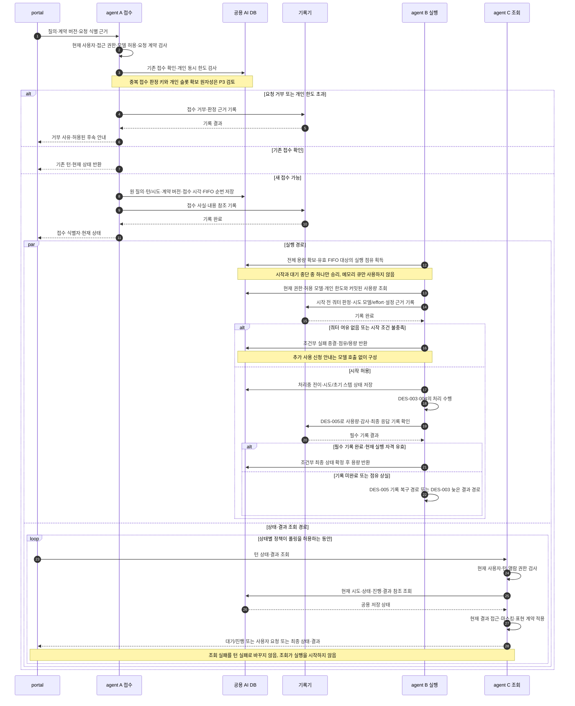

# 질의 접수·폴링과 상세 시퀀스 연결

아래 ‘읽는 순서’의 번호는 여러 메시지를 업무 단계로 묶은 설명 번호이며, 그림의 화살표 자동 번호와는 다릅니다. 조건에 맞는 분기만 실행하고, 병행 경로는 동시에 진행됩니다.

REQ-010의 [전체 흐름도](../generated/10-요구사항정의서/04-요구사항/02-질의-해석과-실행.md#req-010-전체-흐름도)를 구현 관점으로 읽는 상세 시퀀스 초안이다.
제품 사실의 정본은 [요구사항](../spec/10-requirements/_index.yaml)과 [아키텍처](../spec/20-architecture/_index.yaml)이며, 이 문서로 미확정 정책이나 게이트를 승인하지 않는다.
그림은 논리 처리 순서를 제안한다. 클래스·API 이름·DB 테이블·트랜잭션 구현 방식은 P3에서 확정한다.

## 1. 읽는 순서와 주체

**검토 시작:** [전체 흐름도와 단계별 대응표](../generated/10-요구사항정의서/04-요구사항/02-질의-해석과-실행.md#req-010-전체-흐름도) → 해당 S 번호의 다이어그램 또는 순서 설명 → 관련 처리 경로 → 전체 흐름도 복귀. S1~S8은 검토용 순번이며 실제 실행 순서가 아니다.

| 문서 | 시퀀스 | 구현 시 확인할 것 |
|---|---|---|
| 이 문서 | 접수·용량 확보·폴링 | 시작 전 쿼터, 영속 접수, 다른 인스턴스의 조회, 최종 상태 |
| [실행 수명주기](agent-lifecycle-sequences.md) | 사용자대기·이어가기, 변경·중단, 장애·만료·새 시도 | 상태와 LangGraph, 점유·용량, 이벤트 순서·늦은 결과 |
| [모델·도구·임베딩](agent-call-sequences.md) | 반복 모델 호출, SQL·업무 API, 임베딩 | 호출 전 검사, 승인, 응답 검증, 사용량·부분 실행 |
| [기록과 종결](agent-history-sequences.md) | 감사·사용량 저장, 기록 실패·종결 | 별도 트랜잭션, 중복 계량 방지, 결과 공개·조회 |

portal은 브라우저 화면이다. agent A·B·C는 같은 기능을 제공하는 서로 다른 실행 인스턴스다.
DB는 공용 AI 전용 DB이고, 기록기는 별도 서버가 아니라 감사·사용량 저장의 논리 역할이다.
권한/쿼터 판정 역시 서비스 배포 단위를 뜻하지 않는다. 외부 업무 시스템·모델과 AI DB를 하나의 트랜잭션으로 묶지 않는다.
그림의 `기록`은 [DES-005](agent-history-sequences.md)의 실패 경로를 포함한다. 성공 응답이 없으면 후속 성공 경로로 진행하지 않는다.

## S1 접수 시작 비동기 폴링

**S1 검토 위치** — [REQ-010 요구사항](../generated/10-요구사항정의서/04-요구사항/02-질의-해석과-실행.md#req-010-요구사항) · [전체 흐름도](../generated/10-요구사항정의서/04-요구사항/02-질의-해석과-실행.md#req-010-전체-흐름도) · [단계별 대응표](../generated/10-요구사항정의서/04-요구사항/02-질의-해석과-실행.md#req-010-단계별-대응표) · [이 그림의 순서 설명](#s1-읽는-순서)

**관련 처리 경로** — [S2 반복 모델 호출과 쿼터 검사](agent-call-sequences.md#s2-반복-모델-호출과-쿼터-검사) · [S4 질의 임베딩·지식 재임베딩](agent-call-sequences.md#s4-질의-임베딩-지식-재임베딩) · [S7 점유 만료·늦은 응답·새 시도](agent-lifecycle-sequences.md#s7-점유-만료-늦은-응답-새-시도) · [S8 감사·사용량·최종 응답 종결](agent-history-sequences.md#s8-감사-사용량-최종-응답-종결)

**검토 순서** — [S2 다음 검토 →](agent-call-sequences.md#s2-반복-모델-호출과-쿼터-검사)

근거: REQ-009·016·036·040, ARCH-015, NFR-012·023·027. `접수`와 `처리중`은 별개다.

### S1 읽는 순서

1. portal이 사용자 질의와 요청 식별 정보를 agent A에 보냅니다. A는 사용자 권한, 선택한 모델의 허용 여부, 메시지 형식을 확인합니다.
2. A는 같은 요청이 이미 접수됐는지와 개인 동시 처리 한도를 확인합니다. 허용되지 않는 요청은 사유를 기록하고 거부하며, 이미 접수된 요청이면 새로 실행하지 않고 기존 턴의 상태를 돌려줍니다.
3. 새 요청을 받을 수 있으면 원 질의, 턴과 시도, 접수 시각, 대기 순서를 공용 DB에 저장합니다. 기록기인 감사·사용량 기록 서비스가 접수 이력을 저장한 뒤 portal에 접수 결과를 보냅니다. 이 시점에는 업무 처리가 끝난 것이 아닙니다.
4. 접수 이후에는 **실제 실행과 portal의 상태 조회가 나란히 진행됩니다.** 아래 실행 설명을 모두 마친 다음에 폴링을 시작한다는 뜻이 아닙니다.
5. 실행을 맡은 B는 전체 실행 여유가 생기면 유효한 대기 요청을 먼저 접수된 순서로 선택하고 실행 점유를 얻습니다. 여유가 없으면 요청은 공용 DB의 대기열에 남습니다.
6. B는 실제 시작 직전에 현재 권한, 허용 모델, 개인 쿼터 한도와 이미 저장된 사용량을 확인하고 판정 근거를 기록합니다. 쿼터가 부족하거나 시작 조건을 충족하지 못하면 실행하지 않고 실패로 종결하며 점유와 용량을 반환합니다.
7. 시작이 허용되면 처리중 상태와 초기 실행 상태를 저장하고 모델·도구 호출 등을 수행합니다. 결과와 필수 감사·사용량 기록을 확인하고 실행 자격이 유효할 때만 최종 상태를 확정합니다. 기록 실패나 점유 상실이면 해당 예외 경로로 갑니다.
8. 이와 동시에 portal은 C에 같은 턴의 상태를 반복 조회합니다. C는 매번 현재 열람 권한을 확인하고 공용 DB의 상태와 허용된 결과를 반환합니다. C가 조회를 받는다고 해서 업무를 다시 실행하지는 않습니다.
9. portal은 대기·진행·사용자 확인 요청을 표시하고, 완료·실패·중단 같은 최종 상태를 확인하면 해당 처리의 폴링을 끝냅니다. 일시적인 조회 오류는 턴의 실패로 단정하지 않으며, 사용자대기 중 폴링 방식은 아래 검토표의 미확정 항목입니다.

[↑ S1 다이어그램](#s1-접수-시작-비동기-폴링) · [전체 흐름도로 돌아가기](../generated/10-요구사항정의서/04-요구사항/02-질의-해석과-실행.md#req-010-전체-흐름도) · [S2 다음 검토 →](agent-call-sequences.md#s2-반복-모델-호출과-쿼터-검사)

전체 용량이 없으면 DB 접수 상태로 대기하며, 용량 확보 후 실제 시작 직전에 쿼터를 검사한다.
접수 시 사전 표시를 위한 쿼터 조회를 하더라도 시작 시 재확인을 대신하지 않는다. 검사 기준은 커밋된 사용량이고 선차감·예약은 하지 않는다(NFR-012).
접수 응답을 잃은 경우의 요청 재전송은 새로운 접수와 구분해야 한다. 정확한 키·유효 범위·보존 기간은 P3 설계 후속이다.

## 3. portal 상태별 표시·폴링 검토표

| 서버에서 확인한 상태 | 화면 동작 | 설계 검토 지점 |
|---|---|---|
| 접수·실행 순서 대기 | 대기 상태·경과 시간 표시, 처리 상태 조회 | 큐 순번 노출 여부·주기 |
| 처리중 | 단계·경과 시간 표시, 최종 상태까지 조회 | 상태 변경 시각·유효 폴링 주기·횟수 계측(NFR-007) |
| 사용자대기 | 해당 시도·대기 카드 표시, 응답 입력 | 폴링 유지/일시 중지·응답 뒤 재시작·대기 만료 표시 계약은 미확정 |
| 완료·실패·중단 | 최종 상태·허용 결과·부분 처리 내역 표시, 해당 처리의 폴링 종료 | 중단만으로 재시도 버튼을 허용하지 않음 |
| 일시적 네트워크/조회 오류 | 연결 문제로 표시, 최종 상태를 추정하지 않음 | 조회 재시도 간격·상한·재접속 정책은 미확정 |
| 권한 회수·미지원 계약 버전 | 결과 접근을 차단하고 기존 정책의 안내 | 일시 조회 오류와 구분; ARCH-019 버전 전환 규칙 적용 |

화면 이탈·로그아웃은 서버 턴의 중단 요청이 아니다(REQ-016). 재접속은 REQ-040의 현재 턴 조회이며 신규 실행이 아니다.
`완료`는 서버의 필수 기록·최종 결과 저장 완료를 의미한다. 브라우저가 수신·열람했다는 의미로 쓰지 않는다(TS-06).
서버가 통제하지 않은 LLM 청크를 portal로 직접 전달하지 않는다. 모델 스트리밍과 portal 폴링은 별개 경로다.

## 4. 요구사항과 구현 검증 연결

| 범위 | 근거 | 검증해야 할 반례 |
|---|---|---|
| 접수·폴링 | REQ-009·016·018·036·040 | 폴링이 새 턴 생성, 접수 응답 유실로 중복 실행 |
| 상태·점유·복원 | REQ-013·030·033·109, ARCH-070 | 만료 응답으로 복원, 옛 점유자가 완료 상태 덮어쓰기 |
| 호출·보안 | REQ-009·038·102~106·111~113 | 미완성 출력·임의 도구·권한 회수된 결과 사용 |
| 감사·쿼터 | REQ-107·108, NFR-010·012·015·023·027 | 이력 없이 성공, 같은 호출 중복 차감, 취소 사용량 누락 |

## 5. 상세 설계 완료 전 확인할 것

- @defer P3 접수·FIFO 선택·개인/전체 용량·실행 점유·상태 전이의 조건부 갱신과 트랜잭션 경계를 확정한다. 다른 사용자·다른 턴의 중복 업무 실행은 점유만으로 해결하지 않는다.
- @defer P2 사용자대기 중 폴링, 조회 오류 복구, 개인 한도 초과 상태의 사용자 응답 수용 방식을 확정한다. 기존 대기 카드 만료를 자동 연장하지 않는다.
- @defer P3 메시지·필드·오류·감사 이벤트의 실제 계약은 REQ-009 상세 설계와 연결한다. 임의의 구현 메서드 이름을 계약으로 고정하지 않는다.
- @defer P4 실제 운영 API에서 동시 실행·스트리밍 취소·계량·재접속을 검증한다. CLI 통과로 이 검증을 대신하지 않는다.
