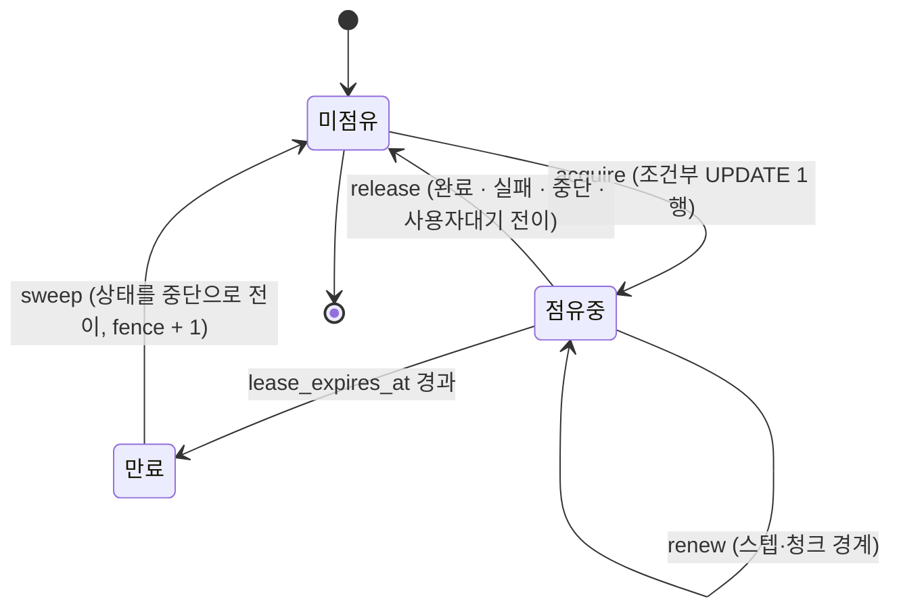

# 턴 실행 점유 — 리스와 점유 토큰

> **status: migrated — 사용자 승인 전이다.** 재편성해 들어왔고
> P3 게이트를 통과하지 않았다.
>
> **규범은 [`spec/20-architecture/_index.yaml`](../spec/20-architecture/_index.yaml) 의 `execution_lease`(ARCH-070) 가 갖는다.**
> 이 문서는 그것을 **구현 수준으로 상세화**한 것이며, 충돌하면 spec 이 우선한다.
> 상태 모델과 회차 규칙은 [`spec/03-glossary/_index.yaml`](../spec/03-glossary/_index.yaml) 의
> `turn_states` · `revision_rules` 가 갖는다.

## 이 문서가 왜 앞당겨졌나

원칙적으로는 화면별 설계에서 agent 요구가 모인 뒤에 쓰여야 한다. 그러나 이 항목은 그 요구들과
무관하게 성립하는 **실행 기반**이며, 여기서 내리는 결정이 **턴 이력 스키마와 오케스트레이션
구조를 함께 규정**하므로 먼저 확정한다 — 스키마는 agent 설계의 산출물이 아니라 **입력**이다.

워크플로우 잡의 점유는 같은 구조를 재사용하되(NFR-024) 상세는 P3 에서 다룬다.

## 1. 문제 — 같은 턴을 둘이 잡는 경로

턴은 수 초에서 수 분 이상 이어지는 지속 작업이고 agent 는 스케일 아웃된다(ARCH-014).
다음 경로로 **같은 턴에 대한 처리가 둘 이상 시작될 수 있다.**

| # | 경로 | 결과 |
|---|---|---|
| 1 | 사용자가 재시도(FEAT-106)를 연타 → 로드밸런서가 서로 다른 인스턴스로 분배 | 같은 턴을 둘이 이어서 처리 |
| 2 | 승인 응답(FEAT-105)이 중복 도착 (더블 클릭·재전송) | **승인 필요 액션이 두 번 실행** |
| 3 | 인스턴스 A 가 정지·재기동 → 턴이 처리중으로 남음 → 다른 인스턴스가 회수 → A 가 사실 살아 있었음 | 두 인스턴스가 같은 지점부터 진행 |
| 4 | GC 정지·네트워크 지연으로 A 가 자신이 밀려난 줄 모른 채 깨어남 | 뒤늦은 쓰기가 새 처리 결과를 덮어씀 |
| 5 | 대기 만료 스위퍼와 사용자의 응답이 동시에 도달 | 만료 처리와 재개가 경합 |

무엇이 깨지는가:

- **비가역 실행의 중복.** 업무 API 는 되돌릴 수 없다. 승인 절차를 통과한 액션이 두 번 나가면
  **승인은 한 번인데 실행은 두 번**이 된다.
- **이력의 혼선.** 두 처리가 같은 턴에 스텝을 남기면 스텝 순번이 중복·역전되고 토큰 대사가 어긋난다.
- **재개 상태의 상호 파괴.** 체크포인트는 재개의 유일한 근거다. 둘이 쓰면 **어느 쪽으로도
  재개되지 않는 상태**가 만들어질 수 있다.

> **그래프 런타임의 내부 락은 답이 아니다.** LangGraph4j `AbstractCheckpointSaver` 의
> `ReentrantLock` 은 **한 JVM 안의 직렬화**만 보장한다. 인스턴스 간에는 아무 효력이 없다.

## 2. 제약에서 유도된 선택

**먼저 무엇을 쓸 수 없는지가 선택을 거의 결정한다.**

| 대안 | 판단 | 이유 |
|---|---|---|
| DB 행 잠금(`SELECT … FOR UPDATE`)을 턴 처리 전체에 유지 | **탈락** | "LLM 응답을 기다리는 구간에 트랜잭션과 커넥션을 열어두지 않는다"(hub-conventions §트랜잭션 경계). 한 턴이 수 분이므로 **커넥션 풀이 즉시 고갈된다** |
| Redis 분산 락 (Redlock 등) | **탈락** | Redis 는 **화면 세션 저장소의 선택지**일 뿐 필수 구성요소가 아니다(CON-010). 점유의 근거로 삼으면 Redis 가 필수가 되어 폐쇄망 운영 구성요소가 늘어난다 |
| 메시지 브로커의 단일 소비자 보장 | **탈락** | 같은 이유 — 운영 구성요소 추가 |
| 단일 인스턴스 운영 강제 | **탈락** | 스케일 아웃을 포기하는 것(CON-009) |
| **AI 전용 DB 의 조건부 갱신 기반 리스** | **채택** | 이미 있는 구성요소만 쓴다. 커넥션을 붙들지 않는다. **원자성은 단일 `UPDATE` 문이 보장한다** |

리스만으로는 **4번 경로(정지 후 부활)를 막지 못하므로 점유 토큰(fence)을 함께 둔다.**
리스는 *지금 누가 갖고 있나* 를, 펜스는 *이 쓰기가 그 소유 구간의 것인가* 를 답한다.

## 3. 설계

### 3.1 필드

`ai_agent_turn` 에 다음을 둔다 (명명과 `timestamptz` 는 hub-conventions).

| 컬럼 | 타입 | 의미 |
|---|---|---|
| `lease_owner` | varchar | 점유 중인 인스턴스 식별자. NULL 이면 미점유 |
| `lease_expires_at` | timestamptz | 점유 만료 시각. NULL 이면 미점유 |
| `lease_fence` | bigint NOT NULL DEFAULT 0 | **점유 토큰.** 점유가 새로 생기거나 회수될 때마다 +1 |
| `lease_acquired_at` | timestamptz | 진단용. 현재 점유의 시작 시각 |
| `revision` | int NOT NULL DEFAULT 0 | **회차.** 되돌려 다시 수행할 때만 +1 |
| `abort_reason` | varchar | 중단 사유 — `LEASE_EXPIRED` / `WAIT_EXPIRED` / 사용자 중단 |

함께 쓰는 기존 필드: `status` · `wait_type` · `wait_expires_at` · `cancel_requested` ·
`action_executed`. 상태·대기 유형의 값은 용어사전의 영문 키를 **대문자 스네이크**로 쓴다.

- **인스턴스 식별자**는 기동 시 생성한 UUID 에 호스트명을 덧붙인 값으로 한다.
  **재기동하면 반드시 달라져야 한다** — 같은 값이면 재기동한 인스턴스가 죽기 전 자신의 점유를
  자기 것으로 오인한다.
- **모든 시각 판정은 DB 서버 시각(`now()`)으로 한다.** 인스턴스의 시스템 시각을 쓰면 시각
  오차가 그대로 점유 판정의 오차가 된다.

### 3.2 생애주기



핵심 규칙 셋:

1. **점유는 스텝을 실제로 돌리는 동안에만 유지한다.** 사용자대기로 전이하면 즉시 놓는다 —
   대기는 길고, 사용자의 응답이 다른 인스턴스로 도착할 수 있다.
2. **처리중(`RUNNING`) 상태의 턴은 직접 획득할 수 없다.** 리스가 만료됐더라도 마찬가지다.
   만료된 턴은 스위퍼가 **중단 상태로 전이시킨 뒤에야** 획득 대상이 된다. 이렇게 해야
   "만료된 턴은 중단으로만 전이하고 자동 재개하지 않는다"(ARCH-070)가 지켜지고, **회수 사실이
   상태 전이로 이력에 남는다.**
3. **점유를 잃은 인스턴스는 어떤 상태 전이도 하지 않는다.** 실패로 기록하지도 않는다.
   조용히 처리를 포기한다.

### 3.3 연산 규약

AI 전용 DB 는 PostgreSQL 고정이므로(CON-001) `RETURNING` 을 사용한다.

#### 획득 — acquire

```sql
UPDATE ai_agent_turn
   SET lease_owner       = :instanceId,
       lease_expires_at  = now() + :ttl,
       lease_fence       = lease_fence + 1,
       lease_acquired_at = now(),
       status            = 'RUNNING',
       updated_at        = now()
 WHERE turn_id = :turnId
   AND status IN ('RECEIVED', 'ABORTED', 'WAITING_USER')
   AND (lease_owner IS NULL OR lease_expires_at <= now())
RETURNING lease_fence;
```

- **1행** → 획득. 반환된 `lease_fence` 를 처리 문맥에 보관하고 이후 모든 쓰기에 사용한다.
- **0행** → 획득 실패. **재시도하지 않고** 호출자에게 "이미 처리 중" 으로 응답한다.
  portal 은 폴링으로 진행 상태를 받으므로(ARCH-015) 이 응답으로 충분하다.
- 진입 가능 상태의 의미 — `RECEIVED` 최초 처리 · `ABORTED` 재시도(REQ-013) ·
  `WAITING_USER` 승인·추가 정보·의도 확인 응답 접수(REQ-005 · REQ-017 · REQ-008).
- **응답 접수 경로에서는 `AND wait_type = :expectedWaitType` 을 함께 걸어** 대기 유형이
  어긋난 재개를 막는다. 승인 응답이 의도 확인 대기 중인 턴을 재개시키는 일이 없어야 한다.
- **병행형 확인(REQ-032)은 이 경로를 타지 않는다.** 턴이 처리중을 유지하므로 점유는 처리 중인
  인스턴스가 계속 쥐고 있고, 확인 응답은 `cancel_requested` 와 같은 방식으로 턴 레코드에
  기록되어 스텝 경계에서 읽힌다.

#### 갱신 — renew (스텝 경계 / 스트리밍 청크 경계)

**중단 요청 확인(REQ-033)과 같은 왕복에서 처리한다.**

```sql
UPDATE ai_agent_turn
   SET lease_expires_at = now() + :ttl,
       updated_at       = now()
 WHERE turn_id     = :turnId
   AND lease_owner = :instanceId
   AND lease_fence = :fence
   AND status      = 'RUNNING'
RETURNING cancel_requested;
```

- **1행** → 점유 유효. 반환된 `cancel_requested` 가 참이면 중단 처리로 넘어간다.
- **0행** → **점유 상실.** `LeaseLostException` 으로 즉시 빠져나온다. 상태 전이도,
  체크포인트 쓰기도 하지 않는다.

**이 한 문장이 중단 확인과 점유 확인을 동시에 수행한다.** 두 검사가 같은 지점에서 일어나야
하는 이유는 같다 — **스텝 경계는 "여기까지는 안전하게 멈출 수 있다" 고 보장되는 유일한 지점**이다.

#### 해제 — release

```sql
UPDATE ai_agent_turn
   SET lease_owner      = NULL,
       lease_expires_at = NULL,
       status           = :nextStatus,     -- DONE / FAILED / ABORTED / WAITING_USER
       wait_type        = :waitType,       -- WAITING_USER 일 때만
       wait_expires_at  = :waitExpiresAt,  -- WAITING_USER 일 때만
       updated_at       = now()
 WHERE turn_id     = :turnId
   AND lease_owner = :instanceId
   AND lease_fence = :fence;
```

- **0행** → 이미 점유를 잃었다. 아무것도 하지 않는다.
- `lease_fence` 는 **해제할 때 올리지 않는다.** 정상 해제는 밀려난 것이 아니므로 무효화할
  이전 소유자가 없고, 다음 획득에서 어차피 +1 된다.

#### 만료 회수 — sweep

```sql
UPDATE ai_agent_turn
   SET status           = 'ABORTED',
       abort_reason     = 'LEASE_EXPIRED',
       lease_owner      = NULL,
       lease_expires_at = NULL,
       lease_fence      = lease_fence + 1,
       updated_at       = now()
 WHERE status = 'RUNNING'
   AND lease_expires_at <= now();
```

- **`lease_fence` 를 올리는 것이 이 문장의 핵심이다.** 죽은 줄 알았던 인스턴스가 되살아나
  `renew`·쓰기를 시도해도 **펜스 불일치로 전부 0행**이 된다 (경로 4).
- **모든 인스턴스가 이 스위퍼를 돌려도 된다.** 동시에 실행되면 두 번째 트랜잭션은 첫 번째의
  커밋 후 조건을 재평가하고 `status <> 'RUNNING'` 이 되어 건너뛴다 —
  **별도의 리더 선출이 필요 없다.**
- **대기 만료도 같은 스위퍼에서 처리한다** — `status = 'WAITING_USER' AND wait_expires_at <= now()`
  조건을 별개 문장으로 함께 실행하고 `abort_reason = 'WAIT_EXPIRED'` 로 구분한다.
  두 만료는 성격이 같다(재개 여지가 있는 멈춤).
- 스위퍼는 주기 실행이며 인스턴스마다 **시작 시각에 지터**를 준다.

### 3.4 쓰기 보호 범위 — 무엇을 막고 무엇을 막지 않는가

**이 절이 이 설계에서 가장 틀리기 쉬운 부분이다.** 모든 쓰기를 펜스로 막으면
전량 감사(PRN-07)가 무너진다.

| 대상 | 펜스로 막는가 | 이유 |
|---|---|---|
| 턴 상태 전이 (`status` · `wait_type` · `lease_*`) | **막는다** | 새 점유자의 처리와 충돌한다 |
| 체크포인트 (`ai_agent_checkpoint`) | **막는다** | 재개의 유일한 근거이므로 둘이 쓰면 재개 불가 상태가 만들어진다 |
| 감사 이력 (스텝·LLM 호출·도구 호출) | **막지 않는다** | 기록 누락은 처리 실패다(PRN-07). 이력은 append-only 이므로 중복은 사후 판별하면 되고 **누락은 복구할 수 없다** |
| `action_executed` 플래그 | **막지 않는다** | "액션이 실행됐다" 는 사실은 점유 여부와 무관하게 참이다. 이 값이 재개 제외 판정의 근거이므로, 막아서 기록되지 않으면 **이미 실행된 액션을 재개가 다시 실행**한다 |
| 토큰 사용량 | **막지 않는다** | 이미 과금된 토큰이다 |

따라서 **감사 이력과 사용량 테이블에는 기록 당시의 `lease_fence` 를 컬럼으로 함께 남긴다.**
중복 기록이 생기면 어느 점유 구간의 것인지 사후에 구분할 수 있고, 스텝 순번의 중복도 이 값으로
설명된다.

> `lease_fence` 로 조건부 쓰기를 확장할 때는 **0행의 의미가 하나로 유지되는지**를 확인한다.
> WHERE 에 점유 외의 조건이 섞이면 0행이 *점유 상실* 과 *그 조건에 맞는 행이 없음* 둘을
> 뜻하게 되고, 후자를 점유 상실로 오판하면 **정상 처리가 실패한다** (PoC 에서 실제로 발생했다).

#### `lease_fence` 만으로는 부족하다 — 회차를 함께 남긴다

**점유 토큰은 "누가 처리했나" 에만 답한다.** 교정(REQ-030 ②)은 같은 점유 안에서 턴을 되돌려
다시 수행하므로, 버려진 시도와 재수행이 **같은 fence 로 같은 스텝 순번**을 남긴다.

```
PoC 실측 (S6-correct · 회차 도입 전)
  step 행 : 4   (seq = 0, 0, 1, 2)   <- 앞의 seq=0 이 버려진 시도
  fence   : 전부 1                    <- 점유는 내내 정상이었다
```

점유가 정상인데도 이력만으로는 **어느 행이 최종 응답의 근거인지 판별되지 않는다.** 토큰 대사는
합계라 여전히 맞지만 **개별 기록을 특정하는 능력이 사라진다** — 품질 신고의 원인 분석(REQ-110),
결과 교정 재요청의 입력(REQ-024), 액션 근거 추적(REQ-107)이 모두 그 능력에 의존한다.

| | `lease_fence` | `revision` |
|---|---|---|
| 답하는 질문 | 어느 **점유 구간**의 기록인가 | 어느 **시도**의 기록인가 |
| 층 | 인프라 — 누가 처리했나 | 업무 흐름 — 무엇을 하려던 시도인가 |
| 올라가는 때 | 점유가 바뀔 때 | 되돌려 다시 할 때 |
| 관측되는 이상 | 중복 기록 · 뒤늦은 쓰기 | 중복 순번 · 버려진 시도 |

- **두 값은 직교하므로 하나로 합치지 않는다.** 한 회차가 여러 점유에 걸칠 수 있고(중단 후 재개),
  한 점유 안에서 회차가 올라갈 수도 있다(교정). 합치면 두 축이 뭉개진다.
- **스텝의 식별자는 `turn_id + revision + seq` 다.** 이력 조회와 인덱스를 이 축으로 잡는다.
- **회차는 점유로 막지 않는다** — 위 표의 감사 이력과 같은 이유다.
- **체크포인트에도 회차를 남긴다.** 재개 근거를 현재 회차로 한정할 수 있고, **이전 회차의
  체크포인트는 재개 근거로서의 수명이 교정 시점에 끝나므로 턴 종결을 기다리지 않고 정리
  대상이 된다**(REQ-109). 체크포인트에는 조회 결과 원문이 통째로 들어 있어 교정 횟수만큼
  차등 저장 우회 경로가 늘어나는데, **이 정리가 그것을 좁힌다.**

#### `action_executed` 의 쓰기 시점 — 호출 직전에 쓴다

**이 값을 언제 쓰느냐가 잔여 창을 대부분 닫는다.** 펜스로 막지 않기로 한 결정이 여기서 의미를
갖는다 — 점유를 잃은 인스턴스도 이 값은 쓸 수 있다.

| 시점 | 결과 |
|---|---|
| 호출 **응답을 받은 뒤** | 호출이 나갔는데 응답 전에 회수되면 값이 `false` 로 남는다. 새 점유자가 재개해 **같은 액션을 다시 실행**한다 |
| 호출 **디스패치 직전** | 회수되어도 값은 이미 `true` 다. 새 점유자의 재개가 재개 제외 규칙에 걸려 차단된다 |

**디스패치 직전에 쓴다.** 별도 트랜잭션으로 즉시 커밋하며, **커밋을 확인한 뒤에** 호출을 내보낸다.

- **위양성을 감수한다.** 호출을 시도했으나 연결조차 되지 않은 경우에도 턴은 재개 불가가 되고,
  사용자는 부분 실행 안내를 받아 새 턴으로 처리한다.
- **이 비대칭은 의도된 것이다.** 위양성의 대가는 *턴 하나를 새로 시작* 이고, 위음성의 대가는
  *되돌릴 수 없는 업무 API 의 중복 실행* 이다. **비교 대상이 되지 않는다.**
- 따라서 이 값의 의미는 "액션이 성공했다" 가 아니라 **"액션이 나갔을 수 있다"** 이다.
  성공 여부는 도구 호출 이력이 답한다.
- **조회 API 에는 적용하지 않는다** — 승인 절차를 실행 API 에만 두는 것과 같은 구분이다.

#### 체크포인트의 조건부 쓰기

```sql
INSERT INTO ai_agent_checkpoint
       (turn_id, checkpoint_id, node_id, next_node_id, seq, state_json, lease_fence, revision, created_at)
SELECT :turnId, :checkpointId, :nodeId, :nextNodeId, :seq, :stateJson, :fence, :revision, now()
  FROM ai_agent_turn
 WHERE turn_id = :turnId AND lease_owner = :instanceId AND lease_fence = :fence;
```

0행이면 `LeaseLostException` 이다. 갱신도 같은 형태의 `WHERE EXISTS` 조건을 건다.

### 3.5 시간 값

| 값 | 기호 | 무엇을 정하나 | 산정 |
|---|---|---|---|
| 점유 유지 시간 | **L** | `acquire`·`renew` 가 만료 시각을 "지금 + L" 로 미룬다 | **갱신 없이 지날 수 있는 최장 구간 + 여유** |
| 갱신 주기 | **R** | 처리 중인 인스턴스가 `renew` 를 치는 간격 | **L / 3 이하** — 한 번의 갱신 실패로 즉시 점유를 잃지 않게 한다 |
| 스위퍼 주기 | **S** | 만료된 점유를 찾아 회수하는 배치의 간격 | L 이하. 지터를 준다 |

**세 값의 제약이 선택 폭을 거의 결정한다.**

- `R < L` 이 아니면 정상 처리 중에도 갱신 전에 만료된다.
- **L 이 짧으면** GC 정지나 일시적 DB 지연으로 **멀쩡한 인스턴스가 점유를 빼앗긴다.** 그때 그
  인스턴스는 처리를 포기하므로(3.2 규칙 3) 사용자 입장에서는 **이유 없이 턴이 중단된 것으로
  보인다.**
- **L 이 길면** 인스턴스가 실제로 죽었을 때 사용자가 그만큼 기다린다.
- **인스턴스 사망부터 회수까지의 지연은 최악의 경우 `L + S` 다.** 사용자에게 보이는 복구 시간의
  상한은 L 이 아니라 **L + S** 이며, **두 값을 따로 정하지 말고 이 합을 목표로 잡고 배분한다.**

- **세 값 모두 코드에 박지 않고 운영 설정으로 관리한다**(FEAT-020).
- **기본값은 P1 실측으로 확정한다.** 초기 검토값은 **L=120초 · R=30초 · S=60초**.
- **스트리밍 수신 중에는 청크 경계에서 갱신한다.** REQ-034 가 이미 청크 경계 검사를 요구하므로
  추가 비용이 없고, 한 스텝이 L 보다 길어도 점유가 유지된다.
- **스트리밍을 지원하지 않는 구현체**(CLI Provider · CON-033)에서는 별도 스케줄러 스레드로
  갱신한다. 다만 이 갱신은 *프로세스가 살아 있다* 만 증명하고 *처리가 진행 중이다* 는 증명하지
  못한다. **개발 환경에 한정하고 운영 구성으로 삼지 않는다.**

#### 갱신 없이 지날 수 있는 최장 구간

L 을 "LLM 타임아웃 + 여유" 로만 잡으면 **도구 실행 구간이 산정에서 빠진다.** §4 의 결합에서
`renew` 는 `BeforeCall` 훅, 즉 **노드 진입 시점에 한 번**이고 노드 본문이 도는 동안에는 갱신이
없다. LLM 구간은 청크 경계 갱신이 덮지만 **도구 노드 본문에는 대응하는 장치가 없다.**

특히 실행 API 호출은 **대상 시스템의 제한 응답(429 등)을 존중해 백오프·재시도**하므로
(AUTHZ-080), 한 번의 도구 노드가 LLM 타임아웃보다 오래 걸리는 것이 이상 상황이 아니다.
이 구간이 L 을 넘기면 **정상 처리 중인 인스턴스가 회수되고**, 새 점유자가 마지막
체크포인트(도구 노드 진입 전)부터 재개해 **같은 호출을 다시 낸다.**

| 방식 | 내용 | 대가 |
|---|---|---|
| **(가) 도구 노드 본문에서도 갱신** | 도구 실행을 R 주기 갱신과 함께 수행한다. 갱신 실패는 `LeaseLostException` 이나 **이미 나간 호출을 되돌리지는 못한다** | 도구 실행 경로에 갱신 스레드가 붙는다 |
| **(나) L 을 실행 API 기준으로 산정** | L ≥ max(LLM 타임아웃, **백오프·재시도를 포함한 실행 API 타임아웃**) + 여유 | L 이 커지면 복구 지연(L + S)이 함께 커진다 |

**(나)를 기본으로 하고, 등록 시점에 (나)로 감당되지 않는 API 가 나오면 그 API 에 한해 (가)를
적용한다.** L 은 전역 값이므로 **가장 느린 API 하나 때문에 전체 복구 지연을 늘리는 것은
합리적이지 않다.** API 등록 명세에 타임아웃·재시도 정책이 이미 들어가므로(FEAT-004), L 산정의
입력을 등록 정보에서 얻을 수 있다.

> **이 경로에서는 정상 운영 중에도 `LEASE_EXPIRED` 회수가 발생한다.** §6 의 "`LEASE_EXPIRED`
> 회수 건수는 0 에 가까워야 한다" 는 판독 기준이 이 값을 잘못 잡으면 무의미해지므로,
> 회수 건수를 볼 때 **직전 노드가 도구 노드인 건을 분리해 집계한다.**

## 4. 동시성 시나리오별 결과

| # | 상황 | 결과 |
|---|---|---|
| 1 | 재시도 연타 | 첫 `acquire` 만 1행. 나머지는 0행 → "이미 처리 중" 응답. 사용자는 폴링으로 진행을 본다 |
| 2 | 승인 더블 클릭 | 첫 요청이 `WAITING_USER → RUNNING` 으로 전이시키며 획득. 두 번째는 상태 조건 불일치로 0행. **액션은 한 번만 실행된다** |
| 3 | 인스턴스 사망 | L 경과 후 스위퍼가 `ABORTED(LEASE_EXPIRED)` 로 전이. 사용자가 재시도하면 새 인스턴스가 획득해 마지막 체크포인트부터 재개. `action_executed` 가 참이면 재개 대상에서 제외되고 새 턴으로 안내한다 |
| 4 | GC 정지 후 부활 | 스위퍼가 이미 `lease_fence` 를 올렸다. 부활한 인스턴스의 `renew` 가 0행 → 아무것도 쓰지 않고 포기. **이미 실행된 액션과 발생한 토큰은 이력에 남아 있다** |
| 5 | 대기 만료와 사용자 응답의 경합 | 둘 다 `WAITING_USER` 조건의 조건부 갱신이므로 하나만 성공한다 |
| 6 | 처리 중 DB 에 접근할 수 없게 됨 | `renew` 가 예외로 실패 → 처리 포기. **DB 에 쓸 수 없으면 이력도 남길 수 없어 어차피 PRN-07 위반이므로, 계속 진행하지 않는 것이 옳다** |

## 5. 그래프 런타임과의 결합

| 지점 | 구현 |
|---|---|
| 점유 획득 | 그래프 실행 **전에** `acquire`. 얻은 `lease_fence` 를 `RunnableConfig.metadata` 에 싣는다. `threadId` 는 턴 ID 다 |
| 리스 갱신 + 중단 확인 | **`BeforeCall` 노드 훅**에서 `renew` 한 문장을 실행하고 반환된 `cancel_requested` 를 **상태에 넣어 되돌린다** |
| 중단 판정 | `InterruptableAction.interrupt()` 가 상태의 `cancelRequested` 를 읽어 인터럽트 여부를 결정한다 |
| 점유 상실 | `BeforeCall` 훅이 `LeaseLostException` 으로 실패한다. **인터럽트가 아니라 예외여야 한다** — 인터럽트는 "재개 가능한 멈춤" 을 뜻하는데, 점유를 잃은 인스턴스는 그 턴에 대해 아무 권한이 없다 |
| 체크포인트 쓰기 | saver 의 삽입·갱신에 조건부 쓰기를 적용한다 |
| 점유 해제 | 그래프가 끝나거나 인터럽트로 멈춘 뒤, 결과를 턴 상태로 번역하는 자리에서 `release` |

**갱신을 `BeforeCall` 에 두고 판정을 `interrupt()` 에 두는 이유는 실행 순서 때문이다.**

```
BeforeCall 훅  →  interrupt() 판정  →  WrapCall 체인  →  노드 본문  →  AfterCall 훅
```

`interrupt()` 가 `BeforeCall` 보다 뒤에 있으므로 앞에서 읽은 값을 뒤에서 쓸 수 있다.
**DB 왕복은 노드당 1회다.**

> **이 배치는 LangGraph4j 의 훅 실행 순서에 의존한다.** 버전이 올라가며 순서가 바뀌면
> **조용히 깨진다.** **훅 순서를 고정하는 회귀 테스트를 함께 둔다.**

또한 `WrapCall` 훅은 **인터럽트된 노드에서는 실행되지 않으므로**, 승인 대기·중단 전이의 기록은
훅이 아니라 오케스트레이터가 `InterruptionMetadata` 를 받는 자리에서 남긴다.

## 6. 약속하지 않는 것

**exactly-once 실행을 보장하지 않는다.** 창이 두 종류다.

- **창 A — 정지 후 부활.** `renew` 성공 직후 프로세스가 정지하고 그 사이 리스가 만료·회수되면,
  부활한 인스턴스가 이미 통과한 검사를 근거로 한 번 더 도구를 실행할 수 있다.
  **성립 조건이 가혹하다** — 최소 L, 최악 L + S 동안 얼어 있다가 깨어나야 한다.
- **창 B — 갱신 없이 지나는 긴 도구 실행.** 도구 노드 본문이 L 을 넘기면 **정상 처리 중인
  인스턴스가 회수된다.** 백오프·재시도를 포함한 실행 API 호출에서 현실적으로 발생한다.
  **창 A 와 달리 장애가 없어도 열린다.**

완화 수단은 네 겹이다. ① `action_executed` 를 **호출 디스패치 직전에** 쓴다 — 창 A·B 모두에
대해 가장 효과가 크다 ② 비가역 액션 실행 직전에 `renew` 를 한 번 더 수행해 창 A 를 최소화한다
③ `action_executed` 가 참인 턴은 재개 대상에서 제외된다 ④ 승인 필요 액션은 사용자 승인을
다시 거친다.

> **④는 승인 필요 등급에만 적용된다.** 위험 등급별로 승인 강제 여부를 설정하게 되어 있으므로
> **승인 불필요로 설정된 실행 API 에 잔여 위험이 집중된다.** 등급 설정 시 이 점을 고려한다.

- 완전한 중복 방지는 레거시 API 의 멱등성에 의존하는데, **PRN-09 에 따라 우리가 그것을 요구할
  수 없다.**
- **막지 못한 중복은 사후 전수 검출된다.** 감사 이력에 `lease_fence` 를 남기므로
  `같은 turn_id + 같은 도구·파라미터 + 서로 다른 lease_fence` 가 중복 실행 후보다.
  **이 설계가 약속하는 것은 "중복이 0" 이 아니라 "중복이 생기면 반드시 드러나고 복구 절차로
  넘어간다" 이다.**
- **서로 다른 턴 사이의 중복은 이 설계의 범위 밖이다**(REQ-113).
- **점유가 처리 지연을 줄이지 않는다.** 즉시 감지는 하트비트 채널을 따로 두어야 가능한데,
  그것은 운영 구성요소를 늘리는 선택이다.
- **스위퍼는 자동 재개를 하지 않는다.** 중단 상태로 만들 뿐이며 재개는 사용자 요청이다.

## 7. 관측 — FEAT-031 에서 조회한다

| 지표 | 읽는 법 |
|---|---|
| 점유 획득 실패 건수 | 정상 범위. 급증하면 재시도 연타 또는 폴링 오동작 |
| `LEASE_EXPIRED` 회수 건수 | **0 에 가까워야 한다.** 잦으면 L 이 짧거나 인스턴스가 불안정하다. **직전 노드가 도구 노드인 건은 분리해 집계한다** — 그쪽이 늘면 인스턴스가 아니라 L 산정의 문제다 |
| `WAIT_EXPIRED` 회수 건수 | **대기 유형별로 집계한다** — 승인 방치와 의도 확인 방치는 원인도 조정 대상도 다르다 |
| 점유 상실 감지 건수 | 0 이 아니면 경로 4 가 실제로 발생하고 있다는 뜻 |
| **중복 실행 후보 건수** | `같은 turn_id + 같은 도구·파라미터 + 서로 다른 lease_fence`. **0 이어야 한다.** 0 이 아니면 §6 의 창이 실제로 열린 것이므로 개별 건을 복구 절차로 넘긴다 |
| 평균·최대 점유 유지 시간 | L 산정의 근거 |
| 도구 노드 최대 실행 시간 | L 산정의 입력. 실행 API 가 L 에 근접하면 §3.5 의 (가)를 검토한다 |

## 8. 검증 결과

**이 설계는 PoC 에 구현해 실행 검증을 마쳤다** (리스 L1~L6: 2026-08-31 · 회차: 2026-09-01).
PoC 코드는 **이 저장소에 들어오지 않았다** — 제품 코드가 아니며 판단이 끝나면 폐기하기로 한
검증 코드다. **그래서 아래 결과는 다시 돌려 확인할 수 없다**(ASM-003).

| # | 시나리오 | 성공 판정 | 결과 |
|---|---|---|---|
| L1 | 8개 스레드가 같은 턴을 동시에 `acquire` | 정확히 하나만 1행 | **PASS** — 성공 1건(fence=1), 나머지 7건 실패. 처리중 상태의 추가 획득도 거부 |
| L2 | 6개 스레드가 승인 응답을 동시 접수 | 액션 실행 이력이 정확히 1건 | **PASS** — 5건 `LEASE_BUSY`, 1건 완료. `execute_api` 실행 1건 |
| L3 | 리스 강제 만료 → 스위퍼 회수 → 재시도 | 중단 전이 후 정상 재개, 도구 재실행 없음 | **PASS** — `ABORTED(LEASE_EXPIRED)`, fence +1, 옛 fence 의 갱신 거부, 재개 정상 |
| L4 | 점유 강탈 후 원 소유자가 계속 진행 | 상태·체크포인트는 거부, **감사 이력은 남음** | **PASS** — 갱신·상태 전이 모두 0행, 감사 이력은 옛 fence 로 기록됨 |
| L5 | 훅 실행 순서 고정 | `BeforeCall → interrupt → WrapCall` | **PASS** — tool 노드 `BeforeCall` 3회 / `WrapCall` 2회 (인터럽트된 1회가 빠짐) |
| L6 | **점유를 쥔 채 프로세스 강제 종료 → 새 프로세스가 회수·재개** | 만료 전에는 회수 안 됨, 만료 후 정상 재개 | **PASS** — 재기동 직후 `RUNNING` 에 죽은 소유자가 남아 있고, 만료 전 스위핑 0건, 만료 후 1건 회수 |
| S6-correct | **교정으로 회차를 올린 뒤 재실행** | 스텝 식별자 `turn + revision + seq` 가 유일하고, `fence + seq` 는 여전히 중복되며, 이전 회차의 체크포인트가 정리된다 | **PASS** — 버려진 시도 `rev=0 seq=0 fence=1` 과 재수행 `rev=1 seq=0 fence=1` 이 갈렸고, 체크포인트는 전부 `rev=1` 만 남았으며 토큰 대사가 일치했다 |

### 8.1 감사 이력의 점유 토큰이 실제로 기능한다

L6 의 최종 이력이다.

```
step 행   : 3  (fence=[1, 1, 3])
turn      : status=WAITING_USER fence=3 owner=(없음)
```

fence 1 은 죽은 인스턴스가 남긴 두 스텝, 2 는 스위퍼가 회수하며 소비한 값, 3 은 재개한
인스턴스의 스텝이다. **§3.4 가 의도한 대로 "어느 점유 구간의 기록인가" 가 이력만으로
판별된다.** L2 에서도 `fence=[1,1,1,2,2]` 와 `execute_api … fence=2` 가 나와 최초 처리
구간과 승인 재개 구간이 구분됐다.

### 8.2 구현에서 확인된 것

| # | 내용 |
|---|---|
| 1 | **리스 연산은 반드시 프록시를 경유해야 한다.** `renewOrThrow` 가 내부에서 `renew` 를 호출하는 **자기 호출** 구조였을 때 `@Transactional` 이 적용되지 않아 `TransactionRequiredException` 으로 실패했다. **리스의 모든 진입점에 트랜잭션 경계를 직접 붙인다** |
| 2 | **`BeforeCall` 훅에서 갱신하고 `interrupt()` 에서 판정하는 배치가 실제로 동작한다.** 훅이 돌려준 값이 상태에 병합되어 `interrupt()` 가 읽었고 DB 왕복은 노드당 1회로 유지됐다 |
| 3 | **회수 지연은 정확히 L 이다.** L6 에서 TTL 을 40초로 두자 새 프로세스가 기동한 뒤에도 만료 전이라 스위핑이 0건이었고 만료 시각을 지나서야 회수됐다 — §6 의 "점유가 처리 지연을 줄이지 않는다" 가 실측으로 확인됐다 |
| 4 | **[PoC 편차] H2 에는 `UPDATE … RETURNING` 이 없어** 획득·갱신을 같은 트랜잭션 안의 `UPDATE` + `SELECT` 두 문장으로 구현했다. `UPDATE` 가 성공한 시점에 그 행은 우리 트랜잭션이 잠그므로 원자성은 동일하다. **운영(PostgreSQL)에서는 한 문장으로 합친다** |
| 5 | **검증 자체의 함정** — L5 의 "인터럽트된 노드는 `WrapCall` 을 타지 않는다" 는 처음에 **허수 검증**이었다. `WrapCall` 훅을 한 노드에만 걸어 두었으므로 없는 것이 당연했다. tool 노드에도 추적용 훅을 걸어 `BeforeCall` 3회 대 `WrapCall` 2회를 비교하는 형태로 바꿔야 실질 검증이 된다 |
| 6 | **재실행이 곧 검증은 아니다.** "회차 도입 후의 L6 재실행" 을 실제로 돌려 보니 L6 에는 교정 경로가 없어 `revision` 이 0 에 머물렀다 — **통과했지만 확인하려던 것을 건드리지도 않았다.** 5번과 같은 함정이 *남은 검증 목록을 쓰는 단계에서* 반복된 것이다. **남은 검증 항목에는 무엇을 볼지가 아니라 어느 값이 무엇으로 나와야 하는지를 적는다** |

### 8.3 회귀

리스 도입 후 기존 시나리오(연속 도구 호출+승인 · 강제 종료 후 재개 · 타 프로세스 중단 ·
비승인)를 다시 돌려 **전부 통과**했고 토큰 대사도 유지됐다. **회차 도입 후 L6 도 다시 돌려
통과했다**(2026-09-01) — `fence=[1, 1, 3]`, `status=WAITING_USER`, 도구 중복 실행 0건,
토큰 대사 일치(172).

**다만 이 실행이 아래 항목을 닫지는 않는다.**

### 8.4 남은 검증

| 항목 | 성공 판정 |
|---|---|
| PostgreSQL 에서의 `RETURNING` 단일 문장 | §8.2 의 4번 편차 해소 — `UPDATE … RETURNING lease_fence` 한 문장이 1행/0행을 정확히 가른다 |
| 진짜 멀티 인스턴스(별도 WAS 2대)에서의 L1·L2 | 현재는 스레드와 프로세스 수준까지만 확인했다 |
| 스트리밍 청크 경계 갱신 | 실모델 확보 후 (CON-033 의 검증 항목과 같은 자리) |
| 훅 순서 회귀 테스트의 CI 편입 | L5 를 자동 회귀에 넣어야 **버전 업 시 조용히 깨지는 것**을 막는다 |
| **회차가 프로세스 재기동을 건너 살아남는가** | **닫히지 않았다.** L6 에는 교정이 없어 `revision` 이 처음부터 끝까지 0 이며 재기동 후에도 0 이 복원될 뿐이다 — **회차를 나르는 경로는 지나가지도 않는다.** 교정으로 `revision` 을 1 로 올린 뒤 점유를 쥔 채 죽고, 재기동한 인스턴스가 `revision=1` 에서 이어가는지를 보는 시나리오가 따로 필요하다(S6-correct + L6). **성공 판정은 재개 후 기록되는 스텝이 `rev=1` 이고 `rev=0` 의 체크포인트가 되살아나지 않는 것이다** |

## 9. 미확정

| # | 항목 | 확정 시점 |
|---|---|---|
| 1 | L·R·S 의 값 | P1 실측 |
| 2 | 스트리밍 미지원 구현체의 갱신 방식을 개발 환경 밖에서도 허용할지 | API Provider 검증 시 |
| 3 | 스위퍼의 실행 주체 — 전 인스턴스 대 지정 인스턴스 | 부하 측정 후. 현재 설계는 전 인스턴스를 전제한다 |
| 4 | 워크플로우 잡 점유의 상세 | P3 |
| 5 | `ai_agent_turn` 의 인덱스 — 스위퍼가 쓰는 `(status, lease_expires_at)` 복합 인덱스의 필요 여부 | 이력 규모 산정 후(CON-025) |
| 6 | **§3.5 의 (가)를 적용할 API 목록** — L 로 감당되지 않는 실행 API 가 실제로 있는지 | P2 API 등록·협의 시 |
| 7 | **중복 실행 후보 판정에서 "같은 파라미터" 의 비교 방식** — 원문 일치인지 정규화 후 비교인지 | P2 |
| 8 | **회차의 반영 범위** — 감사 이력·사용량·체크포인트에 남기기로 했으나, 이력 스키마의 인덱스와 조회 API 의 키를 `turn + revision + seq` 로 바꾸는 작업이 남는다 | `spec/40-domain/_index.yaml` 확정 시 |
